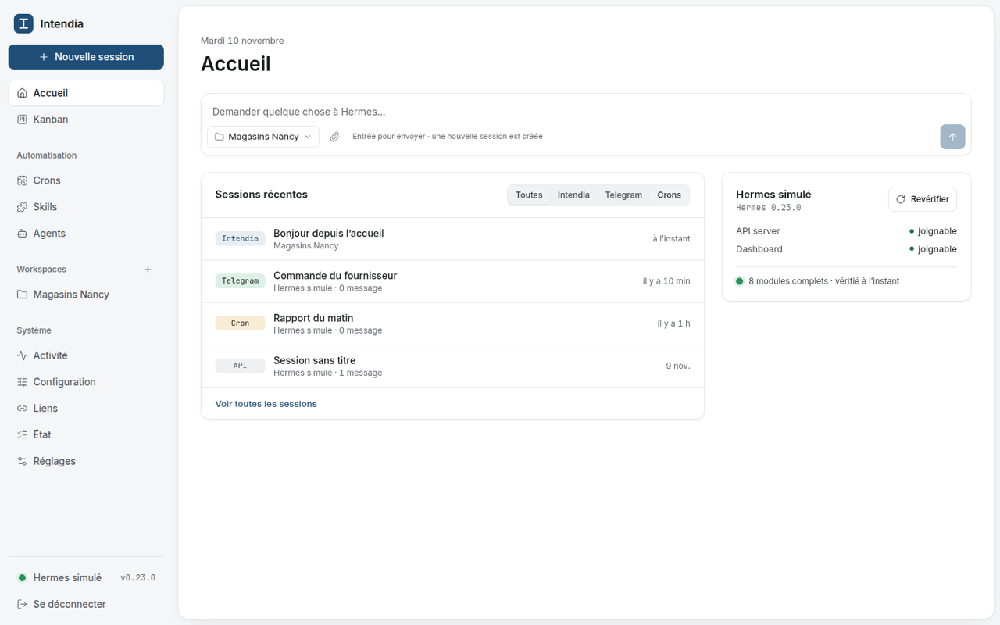
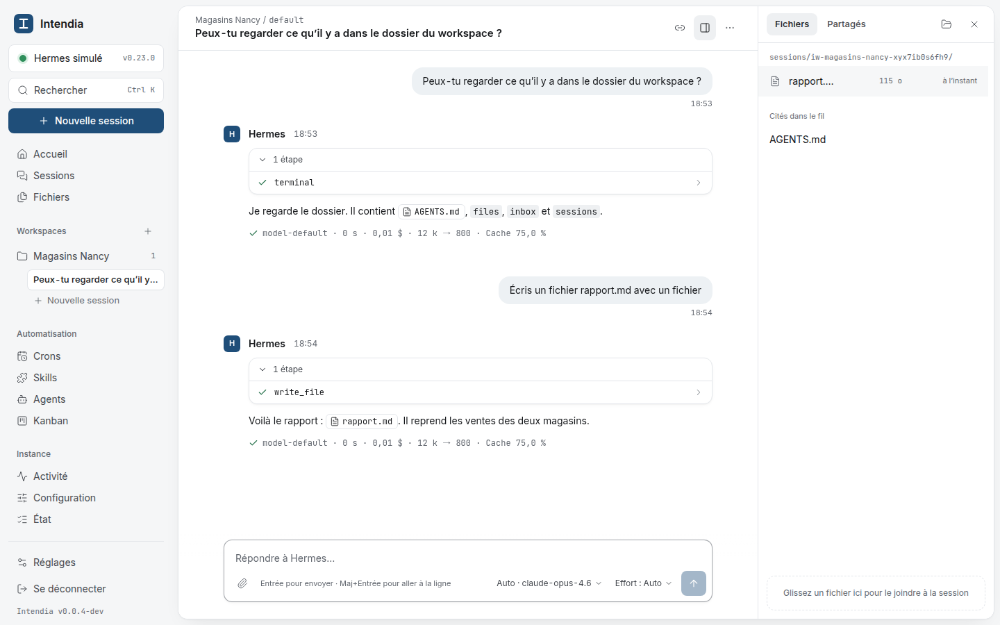
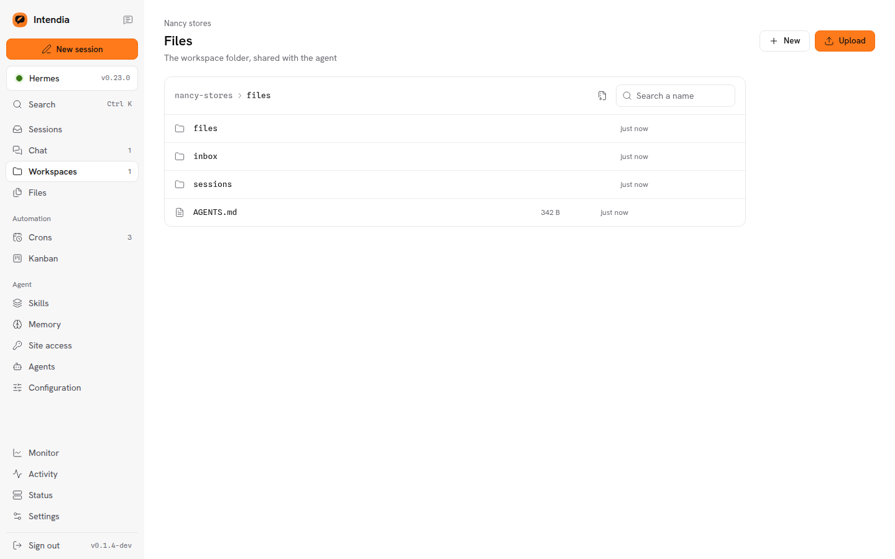
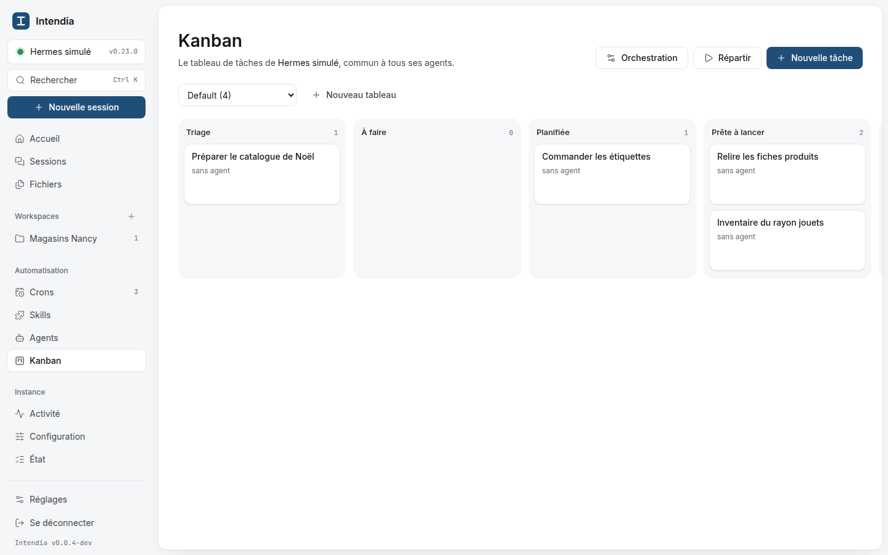
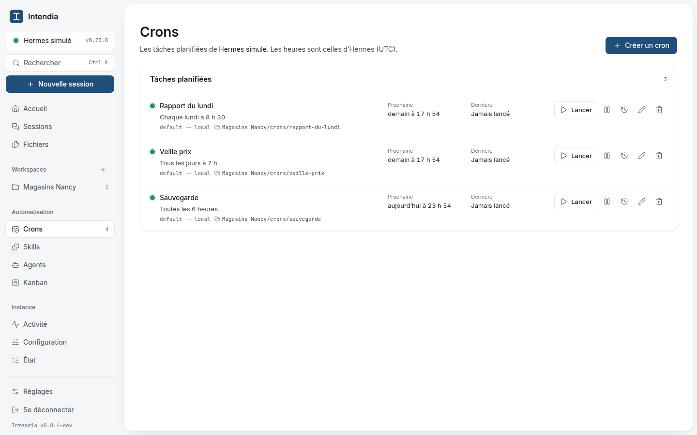
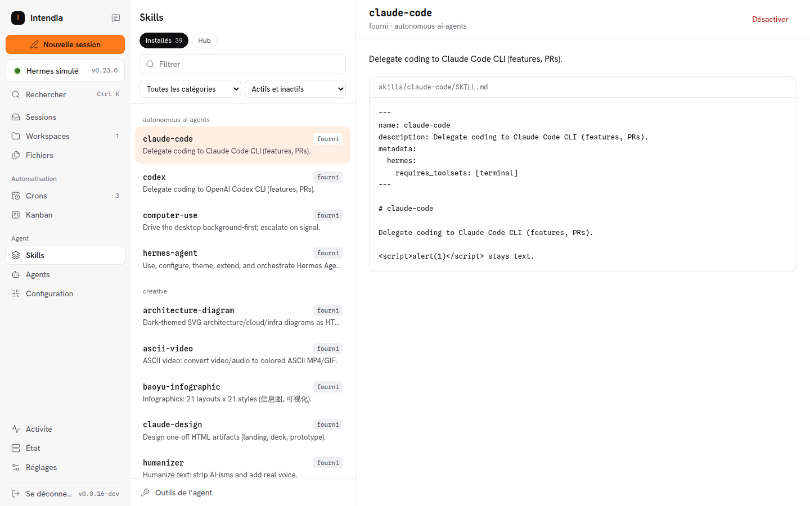
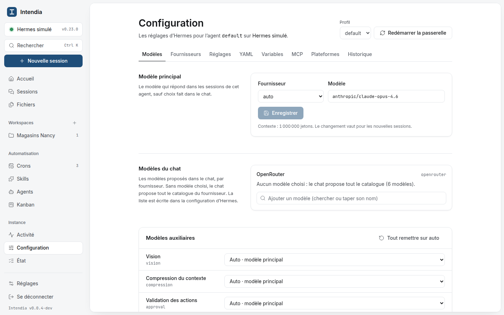
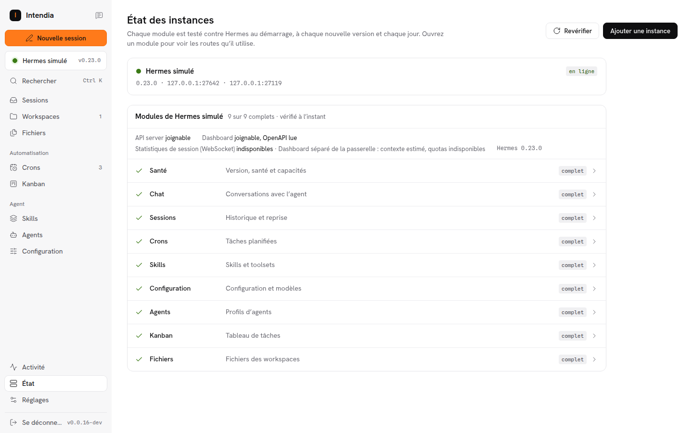

# Intendia

A web UI, in a single container, to **work with** and **administer** [Hermes Agent](https://github.com/NousResearch/hermes-agent)
instances: chat in workspaces that are real folders, the files the agent produces with links, and a console for crons,
skills, settings, agents and the kanban.

Intendia talks to Hermes **only through its HTTP APIs** (API server on 8642, dashboard on 9119). It never imports the
agent's code nor reads or writes its files. Hermes updates itself (tag `latest`); Intendia is built to survive that:

- **One connector per module** (chat, sessions, crons, skills, settings, agents, kanban), each with its own tolerant
  zod schemas. Nothing else in the code calls Hermes (enforced by a test).
- **Routes are discovered, not assumed.** Every operation lists its possible routes by preference; at start-up, on each
  new Hermes version and every day, Intendia keeps the first one the instance really offers, using `/v1/capabilities`
  (API server endpoint map) and `/openapi.json` (dashboard), then calls the read routes and validates the answers.
- **Three states per module**: complete, read-only, unavailable (with the reason and a link to the same page of the
  official dashboard). One broken route degrades one module, never the whole UI.
- **Early warning**: a weekly CI job runs the official `nousresearch/hermes-agent:latest` image and opens an issue when
  an answer changes shape, before users notice. An optional webhook reports state changes on your own instances.

## Status

**0.0.x: development versions.** Every module below is written and tested against a fake Hermes and checked by hand
on a reference Hermes 0.23.0, but Intendia has not been used on a live installation yet. Expect rough edges.

| Area | Content |
|---|---|
| Base | Auth, instances, compatibility engine and State screen, Docker image |
| Work | Workspaces (real folders), sessions, streamed chat with approvals and sub-agents |
| Files | File explorer per workspace and per instance (read-only), previews, share links, `share_file` MCP tool for the agent |
| Console | Crons, skills (hub with security scan), Hermes settings (form, YAML, history), model providers (subscriptions, API keys, custom endpoints, Anthropic setup-token), agents, activity, kanban, site access (logins, cards and addresses of the Hermes vault) |

| | |
|---|---|
|  |  |
|  |  |
|  |  |
|  |  |

## Install

See [docs/install.md](docs/install.md).

## Development

```bash
corepack enable
pnpm install
pnpm dev:fake                 # fake Hermes replaying fixtures/ on 18642 / 19119
INTENDIA_SECRET=$(openssl rand -hex 32) INTENDIA_DATA_DIR=.data pnpm dev
pnpm test                     # server tests run against the fake Hermes
```

`pnpm probe record` records a real instance (read-only) into `fixtures/hermes-<version>/`;
`pnpm probe diff A B` compares two recordings. See [docs/architecture.md](docs/architecture.md).

## License

MIT
