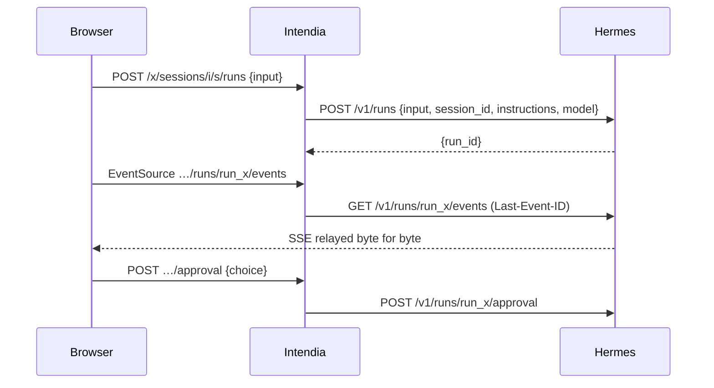

# Architecture

```
apps/server        Hono on Node 24: /x/* API, static SPA, (later) MCP on 3001
  src/hermes/      http.ts — the only HTTP client to Hermes; surface.ts — discovery
  src/connectors/  one folder per module: operations, candidate routes, zod schemas
  src/compat/      engine (route resolution + probes), service (scheduling, history), notify (webhook)
  src/cli/         probe (record / diff), hash-password
apps/web           React 19, Vite, TanStack Router + Query, Tailwind 4
apps/fake-hermes   replays fixtures/ as both Hermes APIs; can break routes on demand
fixtures/          probe recordings, one folder per Hermes version
```

## How a module stays alive across Hermes updates

Each operation of a module (`connectors/<module>/index.ts`) declares:

- `kind`: read or write; `required` reads are needed for the module to work at all;
- `routes`: candidate routes by preference, each on the API server (`api`) or the dashboard (`dash`);
  an API server route may name its `capability` (key in `/v1/capabilities.endpoints`) and `feature` flag;
- `schema`: tolerant zod schema of the fields Intendia reads (`looseObject`: unknown fields are kept).

The compatibility engine (`compat/engine.ts`), for every operation, walks its routes:

1. API server route: skipped if the API is unreachable, if its feature flag is `false`, or if its capability is
   missing from `/v1/capabilities`. When the capability exists, **its announced path replaces the default one**:
   a route moved by Hermes is followed without a code change.
2. Dashboard route: skipped if no dashboard is configured or reachable, or if the route is absent from `/openapi.json`.
3. Read routes without parameters are called and validated against the schema; a failure moves on to the next route.

Module state: `unavailable` if a required read has no working route, `readonly` if a write has none, `full` otherwise.
At runtime `connectors/runtime.ts` (`callOp`, `streamOp`) only uses the route chosen by the last report.

Checks run at start-up, when `/health/detailed` announces a new version (polled every 5 minutes), every 24 h and on
demand from the State screen. State changes go to the webhook.

## Workspaces, sessions and runs

- A workspace (`workspaces` table) = a folder `<mount>/<slug>/` on the volume shared with one instance, served by one
  Hermes profile and one model. `src/workspaces/fs.ts` creates it (`mkdir` without `recursive`, removed if anything
  fails); `src/workspaces/service.ts` owns the rows.
- Intendia mints session ids (`iw-<slug>-<12 base36>`) and records them in `session_workspace` before the first
  message; Hermes creates the session on the first run that carries the id and reloads its history on every run.
- Every run sends `instructions`: workspace name, working folder as the agent sees it (`agentMount`), the session
  folder, the `share_file` rule, and the first 4 KiB of `AGENTS.md`.
- Routes of an Intendia session live under `/x/sessions/<instance>/<id>/…`: the server reads the workspace profile and
  calls Hermes through `/p/<profile>/` with that profile's key.
- Stream: `GET …/runs/<run>/events` relays Hermes's SSE bytes as they are (`id:` = `seq`), forwarding `Last-Event-ID`.
  The browser's `EventSource` reconnects by itself and only gets what it missed. A non-stream answer from Hermes
  becomes one `intendia.error` frame. The client closes the stream on a terminal event; `replay.truncated` is a warning.
- One run at a time per session: sending while the last run is not terminal answers 409.

## Files, share links and MCP

- **Every path chosen by the browser or the agent goes through `src/files/paths.ts`** before any disk access:
  `normalizeRel` (no `..`, NUL, backslash, absolute path), `resolveInside` (realpath must stay under the workspace, or
  under the mount for `share_file`; `create` mode refuses an existing name, dangling links included, then writes with
  `wx`), `resolveEntry` (delete and move act on a symbolic link itself, never on its target), `toVolumePath` (agent or
  Intendia absolute path → path relative to the mount). Known limit: a race between the realpath check and the open
  (no `openat`/`O_NOFOLLOW` in Node).
- The disk is the only source: `src/files/service.ts` reads it on each request (tree, search, raw, upload in a stream,
  move, delete, text save with an mtime check, batch `exists` for chat chips). No file list in the database, no watcher.
- Everything served from the volume (`raw`, `/f/*`) carries `Content-Security-Policy: sandbox; frame-ancestors 'self'`
  (`src/files/send.ts`): agent HTML or SVG gets an opaque origin. Only these responses allow framing by Intendia
  (`X-Frame-Options: SAMEORIGIN`), everything else stays `DENY`. The web preview adds `<iframe sandbox="">` for HTML/SVG,
  not for PDFs (Chrome refuses PDFs in sandboxed frames).
- Share links (`share_links`, `src/links/service.ts`): 10-character base62 token, path relative to the instance mount,
  private by default, public until a date (365 days max), revoked rows kept so `/f/<token>` can say so. A move from the
  explorer rewrites link paths by exact prefix in the same SQLite transaction as the rename (the rename is last).
  `GET /f/<token>` order: unknown/revoked → 404; logged in → file; private → `/connexion?suite=/f/<token>` (the login
  page sends a logged-in user straight back with a full page load, since the `SameSite=Strict` cookie is not sent on a
  navigation from another site); public expired → 410; public → file; missing file → 404 (old path shown to the owner).
- MCP (`src/mcp/server.ts`, port `INTENDIA_MCP_PORT`): hand-written JSON-RPC over Streamable HTTP, stateless, JSON
  answers only; `initialize`, `ping`, `tools/list`, `tools/call` with the single tool `share_file`. Checks: method (405),
  instance (404), bearer token (`settings` key `mcp_token:<instance>`, 401). The agent only ever gets a private link.
- `src/services.ts` builds `WorkspaceService`, `LinkService` and `FileService` once; the web app and the MCP app share them.



## Crons

- `src/crons/service.ts` (`CronService`) calls the `crons` connector; `src/routes/crons.ts` serves
  `/x/i/:inst/crons...` and `/x/crons/upcoming`. Dashboard routes first, API server as a fallback (no history, no
  cancel: the module is then read-only and the page says what is missing).
- Hermes stays the only source: no table. A cron attached to a workspace has a block at the very start of its prompt
  (`[Intendia] Workspace : <name> (<slug>) ; dossier : crons/<key>` ... `[/Intendia]`) asking the agent to read
  `AGENTS.md`, store its files in `<agentPath>/crons/<key>/` and use `share_file`; `workdir` is set to the
  workspace. `unframe` strips the block on read; detaching clears `workdir`. `<key>` is the slug of the cron name when
  first attached, never changed afterwards, unique among the instance's crons and the folders on disk.
- An attached cron is created on the workspace's profile; attaching a workspace of another profile is refused.
- Every action carries the job's `profile` (`?profile=`); Hermes answers 404 when the job is not in it.
- The browser builds the schedule (`apps/web/src/crons/schedule.ts`, plain French forms → `every Nm`, cron
  expressions or an ISO timestamp) and follows "Run now" by polling every 2 s until `last_run_at` changes.

## Skills

- `src/skills/service.ts` (`SkillService`) calls the `skills` connector; `src/routes/skills.ts` serves
  `/x/i/:inst/skills...` (list, enable/disable, SKILL.md, toolsets, hub catalogue, search, scan, install, uninstall,
  update, action status). Every route takes `?profile=` (default `default`) except the action status: Hermes action
  names do not depend on the profile. Skill names may contain `/`, so they travel in the body or the query.
- Dashboard first, also for reads (the API server `/v1/skills` answers 500 in 0.23.0 and has neither `enabled` nor
  `provenance`; `/v1/toolsets` needs a per-profile key). The API server stays as a fallback; a list without
  `enabled` hides the toggle.
- Enabling checks the name first: Hermes accepts any name and adds it to its disabled list.
- Install, uninstall and update are background actions in Hermes (`{ name }` at once, then
  `/api/actions/{name}/status`). Intendia scans before installing and only starts on `policy: allow`, or `ask` with
  `acknowledged: true` (Hermes' `--yes` would accept `ask` silently); anything else is a 409 `scan_refused` with the
  scan. A start whose Hermes action name is already running is a 409 `busy` (name computed as Hermes does,
  `actionName` in the connector). The status keeps only the lines of the last run (after `=== <name> started`).
- The browser polls the status every 1.5 s, keeps pending actions in `sessionStorage` (resumed after a reload) and
  stops on the end, on a 404 (dashboard restarted) or after 5 minutes.
- `AgentService.profiles` (`/x/i/:inst/agents/profiles`) feeds the agent selectors: dashboard profiles, else
  `default` plus the profiles that have an API server key.

## Configuration

- `src/hermes-config/service.ts` (`ConfigService`) calls the `config` connector; `src/routes/config.ts` serves
  `/x/i/:inst/config...` (form, raw YAML, versions and restore, models, env, MCP servers, platforms, gateway restart),
  every route with `?profile=`. Lists come wrapped (`{versions}`, `{env}`, `{servers}`, `{platforms}`).
- No secret reaches the browser: `mask.ts` (`Masker`) replaces each one with `«secret:<id>»` (HMAC of the value) in
  values, YAML text and every text that comes from Hermes; the YAML editor puts them back by id on save and refuses a
  secret moved under a key shown in clear (`secret_moved`).
- Every write that can change the file goes through `ConfigService.write`: per-profile lock, reread of the raw text,
  version check (SHA-256, 16 hex) for form, YAML, restore and model, encrypted copy (10 kept per instance and profile,
  dropped again if Hermes or Intendia refuses the write), Hermes call, new version. Without the raw route, config writes
  are a 409 `config_unavailable`; env and MCP writes go through without copy.
- The browser (`apps/web/src/config/`, page `pages/Config.tsx`) shows the diff before saving, reloads after a 409
  keeping the draft, and offers the gateway restart after a write that needs it (polled every 1.5 s, 5 min at most).

## Agents and activity

- `src/agents/service.ts` (`AgentService`) calls the `agents` connector; `src/routes/agents.ts` serves
  `/x/i/:inst/agents` (list, create), `/agents/profiles` (names only, registered first: a profile may be called
  `profiles`), `/agents/:name/detail` and `/agents/:name/description`.
- An agent is a Hermes profile. `hasKey` says whether Intendia can chat with it (`default`: the instance key; the
  others: `profileKeys[name]`). Creation sends only `name`, `description` and `clone_from`; the page then tells where
  the new key goes (`INTENDIA_INSTANCES` for an `env` instance, `POST /x/instances` for a `db` one). SOUL.md is shown
  read-only, capped at 64 KiB and masked with `Masker.text`. Renaming is not offered (`PATCH /api/profiles/{name}`
  renames).
- Activity and the agent page read the kanban workers through `KanbanService` (see Kanban below), and stop one
  there.
- `src/agents/activity.ts` (`ActivityService`, `GET /x/activity`): Hermes has no run list, so the candidates are the
  last run of each session active in the last 24 h (20 at most, `WorkspaceService.recentRuns`, read by pages and
  skipping runs already known as finished, so an older run still going is reached), checked 4 at a time
  with a 3 s timeout. A finished run, or one Hermes no longer knows (404), goes into an in-memory set (1000 ids) and is
  never asked again. Kanban workers come from every live board of every instance. An unreachable instance is an
  `errors` line, not a failure of the page. The page rereads every 5 s while visible.
- Sub-agents (`apps/web/src/chat/events.ts`, `Subagents.tsx`): one `subagents` entry per run, at the first
  `subagent.start` (keyed by its `run_id`: `seq` is local to a run), nodes keyed by `subagent_id`, drawn as a tree by `parent_id` (unknown parents and cycles at the
  root). A reload during the run rebuilds it from Hermes' replay; Hermes' history has no sub-agent events, so the page
  keeps the trees of the runs that ended while it was open, and they are gone after a reload.

## Kanban

- One kanban for every profile of an instance. `src/kanban/service.ts` (`KanbanService`) never sends `?profile=`,
  always names its board (`?board=`) and never calls `/switch` (the current board is global to Hermes).
  `src/routes/kanban.ts` serves everything under `/x/i/:inst/kanban`. Errors are `KanbanError` with their own status
  (`hermes_conflict`, `worker_ended`, `task_restarted`, `board_exists` 409; `aux_failed` 422).
- A new task starts in `scheduled` ("Planifiée", the only state Hermes leaves alone; `todo` is promoted to `ready`
  as soon as its parents are done): created `ready` **without** its agent (the dispatcher skips it), moved to
  `scheduled`, then given its agent. `ready` (launched by the dispatcher) and `triage` (split by Hermes with
  `auto_decompose`) on request. A task attached to a workspace gets `workspace_kind: "dir"`,
  the folder `<workspace>/kanban/<slug of the title>-<4 hex>` (as seen by the agent) and the `[Intendia]` framing
  block in its body (`src/workspaces/framing.ts`, shared with the crons); the board and the panel show the body
  without it and a badge that opens the folder. Editing the body keeps the block.
- Moves: never to `running` (only the dispatcher starts a worker), only along `GET /workflow`'s `manual` list
  (`apps/web/src/kanban/moves.ts`); drag and drop on wide screens, a "Déplacer vers…" menu on each card everywhere.
  The board moves the card at once and puts it back if Hermes refuses.
- Stopping a worker: `terminate`, then a task Hermes put back in `ready` is moved to `blocked` so the dispatcher does
  not relaunch it. A 404 or 409 from `terminate` is a 409 `worker_ended`; a refused block a 409 `task_restarted`.
- Orchestration (`PUT /kanban/orchestration`) rewrites the `config.yaml` of Hermes' `active_profile`: it goes through
  `ConfigService.write` (source `orchestration`), so the previous file is kept in `config_versions` and can be
  restored from Configuration → History.
- Worker log: the last 200 lines, masked with `Masker.text`. Attachments are served as downloads
  (`Content-Disposition: attachment`, the files CSP, `nosniff`).
- Live updates: `GET /kanban/events?board=` opens Hermes' WebSocket (`src/hermes/events.ts`, the only place allowed
  to open one; the dashboard token stays on the server) and relays each batch as an SSE `event: change` with the task
  ids only, plus a ping every 25 s. If the WebSocket fails, closes or is not open after 10 s (Hermes leaves a wrong
  token's handshake unanswered), the server sends `event: closed` and ends the
  stream; the page (`apps/web/src/kanban/useLive.ts`) then rereads the board every 5 s, says so, and tries the stream
  again after 60 s. The browser never sees the token.

## Rules (enforced by `apps/server/test/boundaries.test.ts`)

- Only `src/hermes`, `src/connectors`, `src/compat` and `src/cli` import `hermes/http.ts`.
- No reference to Hermes files (`config.yaml`, `state.db`, `gateway_state.json`) nor to its Python code.

## When Hermes changes

1. The State screen (or the weekly CI issue) names the operation and the route.
2. `pnpm probe record` against the new version, then `pnpm probe diff fixtures/hermes-<old> fixtures/hermes-<new>`.
3. Fix the connector (new candidate route or schema field), commit the new fixtures; the tests replay them.
