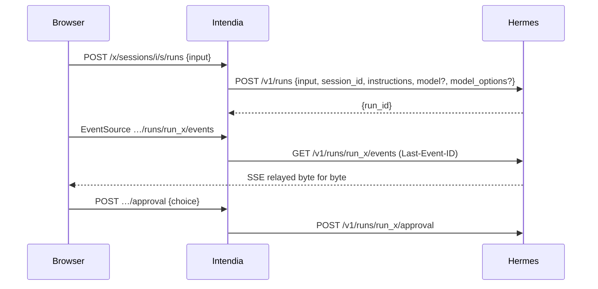

# Architecture

```
apps/server        Hono on Node 24: /x/* API, static SPA, (later) MCP on 3001
  src/hermes/      http.ts — the only HTTP client to Hermes; surface.ts — discovery
  src/connectors/  one folder per module: operations, candidate routes, zod schemas
  src/compat/      engine (route resolution + probes), service (scheduling, history), notify (webhook)
  src/cli/         probe (record / diff), hash-password
apps/web           React 19, Vite, TanStack Router + Query, Tailwind 4
apps/fake-hermes   replays fixtures/ as both Hermes APIs; can break routes on demand
fixtures/          probe recordings, one folder per Hermes version
```

## How a module stays alive across Hermes updates

Each operation of a module (`connectors/<module>/index.ts`) declares:

- `kind`: read or write; `required` reads are needed for the module to work at all;
- `routes`: candidate routes by preference, each on the API server (`api`) or the dashboard (`dash`);
  an API server route may name its `capability` (key in `/v1/capabilities.endpoints`) and `feature` flag;
- `schema`: tolerant zod schema of the fields Intendia reads (`looseObject`: unknown fields are kept).

The compatibility engine (`compat/engine.ts`), for every operation, walks its routes:

1. API server route: skipped if the API is unreachable, if its feature flag is `false`, or if its capability is
   missing from `/v1/capabilities`. When the capability exists, **its announced path replaces the default one**:
   a route moved by Hermes is followed without a code change.
2. Dashboard route: skipped if no dashboard is configured or reachable, or if the route is absent from `/openapi.json`.
3. Read routes without parameters are called and validated against the schema; a failure moves on to the next route.

Module state: `unavailable` if a required read has no working route, `readonly` if a write has none, `full` otherwise.
At runtime `connectors/runtime.ts` (`callOp`, `streamOp`) only uses the route chosen by the last report.

Checks run at start-up, when `/health/detailed` announces a new version (polled every 5 minutes), every 24 h and on
demand from the State screen. State changes go to the webhook.

## Workspaces, sessions and runs

- A workspace (`workspaces` table) = a folder `<root>/<slug>/` kept by the Hermes of its instance, served by one Hermes
  profile. `<root>` (the instance's **workspace root**) is the dashboard's managed files root (`locked_root`, set by
  `HERMES_DASHBOARD_FILES_ROOT`), read at each compatibility check by `src/compat/files-root.ts` (`report.files`); it is
  refused when it is `/`, contains `hermes_home`, or when the agent's terminal is not `local`, and the Files module then
  becomes unavailable with the reason. `src/workspaces/fs.ts` creates the folder through Hermes (refused if the name
  exists, removed if anything fails); `src/workspaces/service.ts` owns the rows. The chat keeps working when the
  dashboard is down: the last AGENTS.md read (kept in memory) is sent, else a line saying it is unavailable.
- Model and reasoning effort are chosen per session, in the chat (`session_workspace.model` / `effort`, NULL =
  Hermes default) and sent as `model` / `model_options.reasoning_effort`. The workspace keeps the last choice
  (`workspaces.model` / `effort`) as the start of its next sessions; it is not a setting of its own.
- Models of the chat's picker, per agent (instance + profile), grouped by provider (`src/chat/models-list.ts`):
  one group per provider with `authenticated: true`, holding the models declared in Hermes for it
  (`providers.<slug>.models` of its config file, read from the raw text by `src/hermes-config/declared.ts`, kept only
  if Hermes returned them too), else the provider's whole catalogue. Intendia keeps no list of its own.
  `GET /x/i/:inst/chat-models` gives `{auto, groups, managed}`; `managed` = Modèles tab available and raw file
  readable (module `config`, ops `get`, `modelInfo`, `raw`); when false, or when the file cannot be read, every group
  is the catalogue. The session keeps the provider of the picked model (`model_provider`, also the workspace's last
  choice) and sends it with the model; Auto sends neither; a model alone (older sessions) is sent without provider.
- Declarations are edited in Configuration › Modèles › « Modèles du chat » (`web/src/config/ChatModels.tsx`):
  `POST /x/i/:inst/config/provider-models {provider, add|remove}`, one change at a time, through
  `ConfigService.changeProviderModels` (lock, history copy, no version check: the change is applied to the current
  text) and `PUT /api/config {config: {providers: {<slug>: {models: [...]}}}}` (Hermes' merge replaces lists). A
  change that changes nothing writes nothing. Mappings, lists of objects, custom endpoints (`base_url`) and
  `custom:<name>` providers are read-only here (YAML tab).
- Auxiliary models: one list per task in the Modèles tab, changes kept in a draft (`web/src/config/aux-draft.ts`)
  and saved together by `POST /x/i/:inst/config/auxiliary {version, changes[1..20], confirm?}`
  (`ConfigService.setAuxiliary`): one version check, one history copy, then one `POST /api/model/set` per task. All
  or nothing: when Hermes refuses task k > 0 (400/422, expensive model to confirm, 404, conflict: nothing written
  for it), the text read before is put back with `PUT /api/config/raw` and the refusal is returned (no copy kept). An
  uncertain error after the first task (timeout, 5xx), or no way to put the file back, answers 502 `partial_write`
  and keeps the copy (Historique tab). `confirm_required` carries the task; the page resends the whole draft with
  `confirm: true`.
- Migrations: `migrate()` applies every file missing from `_migrations` (not only those above the highest id), so
  branches can be merged in any order.
- One `run_stats` row per run started from Intendia: written `running` at send time (options asked for, cost of
  the live session before), settled by `settle()` in `routes/chat.ts` when the messages or the run status are
  read (status, served model, tokens, Hermes times), cost = difference of the live session's cumulated cost,
  re-read for 30 s then frozen (the page re-reads the messages every 5 s meanwhile, `costSettling`). At the next
  send (`handOverCost`), the previous row is frozen on its cost; if Hermes has visibly not costed it yet (tokens
  measured, nothing counted, ended less than 30 s ago), its cost becomes unknown and the new row starts from its
  baseline: its cost then covers both (`cost_runs`, shown as « (2 réponses) »). Pure parts in
  `src/chat/run-stats.ts`; the page shows one line per run under the reply (`chat/RunFooter.tsx`, placement
  `placeRunStats`). fake-hermes: the word `tard` writes the run's cost 8 s after its end.
- Intendia mints session ids (`iw-<slug>-<12 base36>`) and records them in `session_workspace` before the first
  message; Hermes creates the session on the first run that carries the id and reloads its history on every run.
- Every run sends `instructions`: workspace name, working folder as the agent sees it (`<workspace root>/<slug>`), the session
  folder, the `share_file` rule, and the first 4 KiB of `AGENTS.md`.
- Routes of an Intendia session live under `/x/sessions/<instance>/<id>/…`: the server reads the workspace profile and
  calls Hermes through `/p/<profile>/` with that profile's key.
- Stream: `GET …/runs/<run>/events` relays Hermes's SSE bytes as they are (`id:` = `seq`), forwarding `Last-Event-ID`.
  The browser's `EventSource` reconnects by itself and only gets what it missed. A non-stream answer from Hermes
  becomes one `intendia.error` frame. The client closes the stream on a terminal event; `replay.truncated` is a warning.
- One run at a time per session: sending while the last run is not terminal answers 409.
- Session title at Hermes: after the first run of a session settles, `settle()` copies the Intendia title to Hermes
  (`src/workspaces/title.ts`, `pushTitle`, 5 s), so Telegram and the dashboard show the same name.
- Home page: "Demander quelque chose à Hermes…" (`apps/web/src/home/Ask.tsx`) creates the session in the chosen
  workspace, sends the message, then opens the session page. The message is handed over in memory
  (`home/handoff.ts`, read once) so the page shows it while it plugs into the run. "Nouvelle session" in the sidebar
  is `/?nouvelle=1`, which puts the cursor in that box.
- Sessions of every source, per instance: `GET /x/i/:inst/sessions/recent?limit=1..200&source=all|intendia|telegram|cron`
  (`src/sessions/recent.ts`) merges the Intendia sessions of the instance's workspaces (filtered before the limit)
  with the Hermes sessions of that instance only (`default` and the workspace profiles that have a key; 3 s per
  call, errors listed, not fatal). Unknown instance → 404. The source is
  filtered on the server: `intendia` reads the database only, `telegram`/`cron` ask Hermes for that source only. The
  home page shows 7 lines; the Sessions page (`/sessions`, `pages/Sessions.tsx`) groups them by day (browser time)
  and loads 50 more per click, up to 200.
- Search: `GET /x/i/:inst/sessions/search?q=(2..100)&source=` (the instance only) → `{sessions, errors, partial}`, 30 lines at most. Intendia
  titles are matched in the database (`LIKE`, `%`, `_` and `\` literal); message content goes through the
  dashboard's search (op `sessions.search`, FTS5, the hit between `>>>` and `<<<` in `snippet`). A hit on a session
  Intendia owns becomes its Intendia line with the snippet. An instance without dashboard, or whose search answers
  404/500, is listed in `partial` (only Intendia titles were searched there). The snippet is shown as text nodes,
  never HTML (`sessions/marks.ts`).
- Ctrl/Cmd K (`components/CommandPalette.tsx`, logic in `components/palette.ts`): actions, pages, workspaces, crons
  and sessions; without text the latest sessions of the home page, with 2 characters or more the search above.
- Attachments: the composer (`chat/Composer.tsx`) turns pasted, picked or dropped files into tiles, uploads them to
  `inbox/` one by one (`upload` prop), and only adds their paths to the message at send time, one per line after the
  text: that is how the agent reads them. In the thread, `chat/attachments.ts` (`splitAttachments`) takes those last
  path lines out of the user's bubble and shows them as thumbnails or chips, without a server call.
- Thread: entries are grouped into turns (`chat/turns.ts`): one user turn per message, one agent turn up to the
  next message, consecutive tool calls folded into one "étapes" card. Floating menus (`components/Menu.tsx`) are
  portalled to `<body>`.

### During a run

- Approvals and questions of the agent (clarify) are answered from the thread or from the notifications
  (`GET /x/approvals`, `kind: approval|clarify`); the server builds Hermes' exact body from the run status
  (`controlBody`, `routes/chat.ts`).
- Queue: messages written during a run wait in the tab (`web/src/chat/queue.ts`, `sessionStorage` per session) and
  leave one per run when the previous run ends `completed`; a failed or stopped run, a reorientation Hermes did not
  deliver (`pending_steer`, put back in front) or a refused send pauses the queue until « Reprendre ». Nothing leaves
  when the page opens. « Réorienter » sends the text at once (`POST …/runs/:runId/steer`), shown in the thread as a
  user message marked « Réorientation » (local event `intendia.steer` folded into the run, `chat/useRun.ts`).
- Context gauge (`GET /x/sessions/:inst/:id/usage`, `src/chat/usage.ts`): the model's context size from
  `/api/model/info` (Auto or the configured model only); exact figures and plan quota only from `session.stats` of the
  dashboard WebSocket (`src/hermes/gateway-ws.ts`), used when the compatibility check found it (`report.socket`,
  shown on the État page); otherwise the page estimates (`chat/estimate.ts`, « ≈ »). The reply footer shows an
  approximate rate (output tokens over the whole run) and « (secours) » when the served model differs from the one asked.

## Files, share links and MCP

- **No shared volume**: every workspace file goes through the dashboard of the workspace's own instance, connector
  `files` (`GET /api/files`, `/api/files/download`, `POST /api/files/upload-stream` multipart, `/api/files/mkdir`,
  `DELETE /api/files` with a JSON body). `src/files/hermes-fs.ts`: `FileRoots` gives the workspace root of an instance,
  `HermesFs` (one per service call, with a cache of folder listings dropped by each write) takes volume paths
  (`<slug>/files/a.txt`). Hermes confines everything to its root and follows symbolic links, writing and deleting their
  **target**: an entry whose listed `path` is not `<folder>/<name>` (or `broken_link`) is a link, never written, moved
  nor deleted (403 `outside`); a link leaving the root makes Hermes refuse the whole listing of its folder (403).
- Paths chosen by the browser or the agent go through `src/files/paths.ts` first: `normalizeRel` (no `..`, NUL,
  backslash, absolute path), `checkName`, `toVolumePath` (agent absolute path under the root → volume path).
- Hermes is the only source: `src/files/service.ts` asks it on each request (tree, search breadth first 4 folders at a
  time and bounded in entries, results and 5 s, raw, upload in a stream with `overwrite=false`, move of a file = copy,
  links rewritten, then delete of the source; folders cannot be moved, text save with an mtime check, batch `exists`
  with one listing per folder). No file list in the database, no watcher. Hermes down → 502 `unreachable`; no root →
  422 `no_root`.
- Everything served from a workspace (`raw`, `/f/*`) carries `Content-Security-Policy: sandbox; frame-ancestors 'self'`
  (`src/files/send.ts`): agent HTML or SVG gets an opaque origin. Only these responses allow framing by Intendia
  (`X-Frame-Options: SAMEORIGIN`), everything else stays `DENY`. The web preview adds `<iframe sandbox="">` for HTML/SVG,
  not for PDFs (Chrome refuses PDFs in sandboxed frames).
- Share links (`share_links`, `src/links/service.ts`): 10-character base62 token, volume path (relative to the
  workspace root of the instance), private by default, public until a date (365 days max), revoked rows kept so
  `/f/<token>` can say so. A move from the explorer rewrites link paths by exact prefix after the copy and before the
  source is deleted (a failed delete leaves a duplicate, links on the copy). `exists` of the Liens page: one listing per
  instance and folder. Hermes down on `/f/<token>` → a 502 page.
  `GET /f/<token>` order: unknown/revoked → 404; logged in → file; private → `/connexion?suite=/f/<token>` (the login
  page sends a logged-in user straight back with a full page load, since the `SameSite=Strict` cookie is not sent on a
  navigation from another site); public expired → 410; public → file; missing file → 404 (old path shown to the owner).
- MCP (`src/mcp/server.ts`, port `INTENDIA_MCP_PORT`): hand-written JSON-RPC over Streamable HTTP, stateless, JSON
  answers only; `initialize`, `ping`, `tools/list`, `tools/call` with the single tool `share_file`. Checks: method (405),
  instance (404), bearer token (`settings` key `mcp_token:<instance>`, 401). The agent only ever gets a private link.
- `src/mcp/connect.ts` (`McpLink`): puts the server into Hermes through `ConfigService` (dashboard API, `default`
  profile, entry `intendia`). State read from the MCP list and the raw config (headers are not in the list):
  `connected`/`stale` (managed entry: `Authorization: Bearer ${MCP_INTENDIA_API_KEY}`, token sent or not since the last
  rotation, `settings` key `mcp_synced:<instance>`), `manual`, `other_url`, `plugin`, `missing`, `unknown`. Managed
  entry → only `PUT /api/env`; otherwise `ConfigService.replaceMcp` (remove + add in one write, file put back by
  `putRaw` when Hermes refuses the add). Connect and rotate queued per instance; Hermes' test runs after, outside the
  queue. `POST /x/instances` connects a `missing` entry without test. URL: `INTENDIA_MCP_URL` or
  `http://intendia:<INTENDIA_MCP_PORT>`.
- `src/services.ts` builds `FileRoots`, `WorkspaceService`, `LinkService` and `FileService` once; the web app and the
  MCP app share them.



## Crons

- `src/crons/service.ts` (`CronService`) calls the `crons` connector; `src/routes/crons.ts` serves
  `/x/i/:inst/crons...` and `/x/crons/overview` (every active cron of every instance, with its last status and its
  own time zone, errors per instance). Dashboard routes first, API server as a fallback (no history, no
  cancel: the module is then read-only and the page says what is missing).
- Home page: « Aujourd'hui » (`home/Timeline.tsx`) draws the runs of the day computed from each schedule
  (`crons/timeline.ts`: intervals anchored on `next_run_at`, cron expressions with names, ranges, steps, lists,
  @aliases and croniter's day-of-month OR day-of-week rule, `once`), on an axis in Hermes's time (offset of the
  `next_run_at` of a cron without its own zone; a cron with `timezone` is converted with `Intl`). Only the last real
  run is marked (Hermes keeps 20 runs per cron). « Prochains crons » adds a red line per cron whose last run failed;
  the sidebar counts active crons and each workspace's sessions (`sessionCount` of `GET /x/workspaces`).
- Hermes stays the only source: no table. A cron attached to a workspace has a block at the very start of its prompt
  (`[Intendia] Workspace : <name> (<slug>) ; dossier : crons/<key>` ... `[/Intendia]`) asking the agent to read
  `AGENTS.md`, store its files in `<agentPath>/crons/<key>/` and use `share_file`; `workdir` is set to the
  workspace. `unframe` strips the block on read; detaching clears `workdir`. `<key>` is the slug of the cron name when
  first attached, never changed afterwards, unique among the instance's crons and the folders on disk.
- An attached cron is created on the workspace's profile; attaching a workspace of another profile is refused.
- Every action carries the job's `profile` (`?profile=`); Hermes answers 404 when the job is not in it.
- The browser builds the schedule (`apps/web/src/crons/schedule.ts`, plain French forms → `every Nm`, cron
  expressions or an ISO timestamp) and follows "Run now" by polling every 2 s until `last_run_at` changes.

## Skills

- `src/skills/service.ts` (`SkillService`) calls the `skills` connector; `src/routes/skills.ts` serves
  `/x/i/:inst/skills...` (list, enable/disable, SKILL.md, toolsets, hub catalogue, search, scan, install, uninstall,
  update, action status). Every route takes `?profile=` (default `default`) except the action status: Hermes action
  names do not depend on the profile. Skill names may contain `/`, so they travel in the body or the query.
- Dashboard first, also for reads (the API server `/v1/skills` answers 500 in 0.23.0 and has neither `enabled` nor
  `provenance`; `/v1/toolsets` needs a per-profile key). The API server stays as a fallback; a list without
  `enabled` hides the toggle.
- Enabling checks the name first: Hermes accepts any name and adds it to its disabled list.
- Install, uninstall and update are background actions in Hermes (`{ name }` at once, then
  `/api/actions/{name}/status`). Intendia scans before installing and only starts on `policy: allow`, or `ask` with
  `acknowledged: true` (Hermes' `--yes` would accept `ask` silently); anything else is a 409 `scan_refused` with the
  scan. A start whose Hermes action name is already running is a 409 `busy` (name computed as Hermes does,
  `actionName` in the connector). The status keeps only the lines of the last run (after `=== <name> started`).
- The browser polls the status every 1.5 s, keeps pending actions in `sessionStorage` (resumed after a reload) and
  stops on the end, on a 404 (dashboard restarted) or after 5 minutes.
- `AgentService.profiles` (`/x/i/:inst/agents/profiles`) feeds the agent selectors: dashboard profiles, else
  `default` plus the profiles that have an API server key.

## Configuration

- `src/hermes-config/service.ts` (`ConfigService`) calls the `config` connector; `src/routes/config.ts` serves
  `/x/i/:inst/config...` (form, raw YAML, versions and restore, models, env, MCP servers, platforms, gateway restart),
  every route with `?profile=`. Lists come wrapped (`{versions}`, `{env}`, `{servers}`, `{platforms}`).
- No secret reaches the browser: `mask.ts` (`Masker`) replaces each one with `«secret:<id>»` (HMAC of the value) in
  values, YAML text and every text that comes from Hermes; the YAML editor puts them back by id on save and refuses a
  secret moved under a key shown in clear (`secret_moved`).
- Every write that can change the file goes through `ConfigService.write`: per-profile lock, reread of the raw text,
  version check (SHA-256, 16 hex) for form, YAML, restore and model, encrypted copy (10 kept per instance and profile,
  dropped again if Hermes or Intendia refuses the write), Hermes call, new version. Without the raw route, config writes
  are a 409 `config_unavailable`; env and MCP writes go through without copy.
- The browser (`apps/web/src/config/`, page `pages/Config.tsx`) shows the diff before saving, reloads after a 409
  keeping the draft, and offers the gateway restart after a write that needs it (polled every 1.5 s, 5 min at most; `config/restart.tsx`, shared
  with Réglages, which offers the restart after connecting `share_file`).

## Agents and activity

- `src/agents/service.ts` (`AgentService`) calls the `agents` connector; `src/routes/agents.ts` serves
  `/x/i/:inst/agents` (list, create), `/agents/profiles` (names only, registered first: a profile may be called
  `profiles`), `/agents/:name/detail` and `/agents/:name/description`.
- An agent is a Hermes profile. `hasKey` says whether Intendia can chat with it (`default`: the instance key; the
  others: `profileKeys[name]`). Creation sends only `name`, `description` and `clone_from`; the page then tells where
  the new key goes (`INTENDIA_INSTANCES` for an `env` instance, `POST /x/instances` for a `db` one). SOUL.md is shown
  read-only, capped at 64 KiB and masked with `Masker.text`. Renaming is not offered (`PATCH /api/profiles/{name}`
  renames).
- Activity and the agent page read the kanban workers through `KanbanService` (see Kanban below), and stop one
  there.
- `src/agents/activity.ts` (`ActivityService`, `GET /x/i/:inst/activity`, one instance): Hermes has no run list, so the candidates are the
  last run of each session active in the last 24 h (20 at most, `WorkspaceService.recentRuns`, read by pages and
  skipping runs already known as finished, so an older run still going is reached), checked 4 at a time
  with a 3 s timeout. A finished run, or one Hermes no longer knows (404), goes into an in-memory set (1000 ids) and is
  never asked again. Kanban workers come from every live board of the instance. An unreachable instance is an
  `errors` line, not a failure of the page. The page rereads every 5 s while visible.
- Approvals of every instance: `GET /x/approvals` (`ActivityService.approvals`, `src/agents/approvals.ts`) takes the
  same candidates on all instances, and for each run in `waiting_for_approval` reads its events again from the start
  (the question is only in `approval.request`): the stream of a waiting run stays open, so the reading stops 300 ms
  after the last frame (2 s at most). Key `<runId>:<request_id>` (or `seq<id>` without request_id); a question not
  found gives an item without command and choices. One computation at a time, shared 5 s (several tabs poll it).
  The web (`components/Approvals.tsx`) polls it every 10 s and shows a notification with the question, answered in
  place through the session's approval route, whatever the current instance.
- Sub-agents (`apps/web/src/chat/events.ts`, `Subagents.tsx`): one `subagents` entry per run, at the first
  `subagent.start` (keyed by its `run_id`: `seq` is local to a run), nodes keyed by `subagent_id`, drawn as a tree by `parent_id` (unknown parents and cycles at the
  root). A reload during the run rebuilds it from Hermes' replay; Hermes' history has no sub-agent events, so the page
  keeps the trees of the runs that ended while it was open, and they are gone after a reload.

## Kanban

- One kanban for every profile of an instance. `src/kanban/service.ts` (`KanbanService`) never sends `?profile=`,
  always names its board (`?board=`) and never calls `/switch` (the current board is global to Hermes).
  `src/routes/kanban.ts` serves everything under `/x/i/:inst/kanban`. Errors are `KanbanError` with their own status
  (`hermes_conflict`, `worker_ended`, `task_restarted`, `board_exists` 409; `aux_failed` 422).
- A new task starts in `scheduled` ("Planifiée", the only state Hermes leaves alone; `todo` is promoted to `ready`
  as soon as its parents are done): created `ready` **without** its agent (the dispatcher skips it), moved to
  `scheduled`, then given its agent. `ready` (launched by the dispatcher) and `triage` (split by Hermes with
  `auto_decompose`) on request. A task attached to a workspace gets `workspace_kind: "dir"`,
  the folder `<workspace>/kanban/<slug of the title>-<4 hex>` (as seen by the agent) and the `[Intendia]` framing
  block in its body (`src/workspaces/framing.ts`, shared with the crons); the board and the panel show the body
  without it and a badge that opens the folder. Editing the body keeps the block.
- Moves: never to `running` (only the dispatcher starts a worker), only along `GET /workflow`'s `manual` list
  (`apps/web/src/kanban/moves.ts`); drag and drop on wide screens, a "Déplacer vers…" menu on each card everywhere.
  The board moves the card at once and puts it back if Hermes refuses.
- Stopping a worker: `terminate`, then a task Hermes put back in `ready` is moved to `blocked` so the dispatcher does
  not relaunch it. A 404 or 409 from `terminate` is a 409 `worker_ended`; a refused block a 409 `task_restarted`.
- Orchestration (`PUT /kanban/orchestration`) rewrites the `config.yaml` of Hermes' `active_profile`: it goes through
  `ConfigService.write` (source `orchestration`), so the previous file is kept in `config_versions` and can be
  restored from Configuration → History.
- Worker log: the last 200 lines, masked with `Masker.text`. Attachments are served as downloads
  (`Content-Disposition: attachment`, the files CSP, `nosniff`).
- Live updates: `GET /kanban/events?board=` opens Hermes' WebSocket (`src/hermes/events.ts`, the only place allowed
  to open one; the dashboard token stays on the server) and relays each batch as an SSE `event: change` with the task
  ids only, plus a ping every 25 s. If the WebSocket fails, closes or is not open after 10 s (Hermes leaves a wrong
  token's handshake unanswered), the server sends `event: closed` and ends the
  stream; the page (`apps/web/src/kanban/useLive.ts`) then rereads the board every 5 s, says so, and tries the stream
  again after 60 s. The browser never sees the token.

## Rules (enforced by `apps/server/test/boundaries.test.ts`)

- Only `src/hermes`, `src/connectors`, `src/compat` and `src/cli` import `hermes/http.ts`.
- No reference to Hermes files (`config.yaml`, `state.db`, `gateway_state.json`) nor to its Python code.

## When Hermes changes

1. The State screen (or the weekly CI issue) names the operation and the route.
2. `pnpm probe record` against the new version, then `pnpm probe diff fixtures/hermes-<old> fixtures/hermes-<new>`.
3. Fix the connector (new candidate route or schema field), commit the new fixtures. The compatibility tests
   (`compat.test.ts`, schemas in `crons-frame.test.ts`) run on every `fixtures/hermes-*`; the behaviour tests
   and the fake's CLI replay `REFERENCE_FIXTURES` (`apps/fake-hermes/src/index.ts`), a recording made on a used
   instance. CI recordings come from an empty container: move the reference only to a recording with data.
