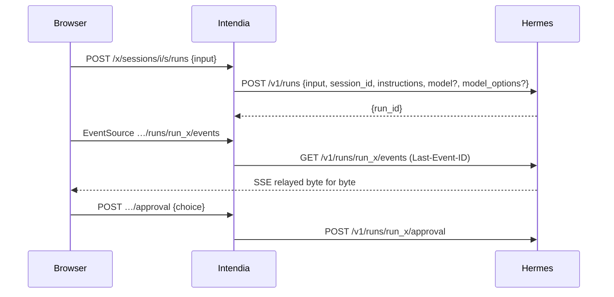

# Architecture

```
apps/server        Hono on Node 24: /x/* API, static SPA, (later) MCP on 3001
  src/hermes/      http.ts — the only HTTP client to Hermes; surface.ts — discovery
  src/connectors/  one folder per module: operations, candidate routes, zod schemas
  src/compat/      engine (route resolution + probes), service (scheduling, history), notify (webhook)
  src/cli/         probe (record / diff), hash-password
apps/web           React 19, Vite, TanStack Router + Query, Tailwind 4
apps/fake-hermes   replays fixtures/ as both Hermes APIs; can break routes on demand
fixtures/          probe recordings, one folder per Hermes version
```

## How a module stays alive across Hermes updates

Each operation of a module (`connectors/<module>/index.ts`) declares:

- `kind`: read or write; `required` reads are needed for the module to work at all;
- `routes`: candidate routes by preference, each on the API server (`api`) or the dashboard (`dash`);
  an API server route may name its `capability` (key in `/v1/capabilities.endpoints`) and `feature` flag;
- `schema`: tolerant zod schema of the fields Intendia reads (`looseObject`: unknown fields are kept).

The compatibility engine (`compat/engine.ts`), for every operation, walks its routes:

1. API server route: skipped if the API is unreachable, if its feature flag is `false`, or if its capability is
   missing from `/v1/capabilities`. When the capability exists, **its announced path replaces the default one**:
   a route moved by Hermes is followed without a code change.
2. Dashboard route: skipped if no dashboard is configured or reachable, or if the route is absent from `/openapi.json`.
3. Read routes without parameters are called and validated against the schema; a failure moves on to the next route.

Module state: `unavailable` if a required read has no working route, `readonly` if a write has none, `full` otherwise.
At runtime `connectors/runtime.ts` (`callOp`, `streamOp`) only uses the route chosen by the last report.

Checks run at start-up, when `/health/detailed` announces a new version (polled every 5 minutes), every 24 h and on
demand from the State screen. State changes go to the webhook.

## Workspaces, sessions and runs

- A workspace (`workspaces` table) = a folder `<root>/<slug>/` kept by the Hermes of its instance, served by one Hermes
  profile. `<root>` (the instance's **workspace root**) is the dashboard's managed files root (`locked_root`, set by
  `HERMES_DASHBOARD_FILES_ROOT`), read at each compatibility check by `src/compat/files-root.ts` (`report.files`); it is
  refused when it is `/`, contains `hermes_home`, or when the agent's terminal is not `local`, and the Files module then
  becomes unavailable with the reason. `src/workspaces/fs.ts` creates the folder through Hermes (refused if the name
  exists, removed if anything fails); `src/workspaces/service.ts` owns the rows. The chat keeps working when the
  dashboard is down: the last AGENTS.md read (kept in memory) is sent, else a line saying it is unavailable.
- Model and reasoning effort are chosen per session, in the chat (`session_workspace.model` / `effort`, NULL =
  Hermes default) and sent as `model` / `model_options.reasoning_effort`. The workspace keeps the last choice
  (`workspaces.model` / `effort`) as the start of its next sessions; it is not a setting of its own.
- Models of the chat's picker, per agent (instance + profile), grouped by provider (`src/chat/models-list.ts`):
  one group per provider with `authenticated: true`, holding the models declared in Hermes for it
  (`providers.<slug>.models` of its config file, read from the raw text by `src/hermes-config/declared.ts`, kept only
  if Hermes returned them too), else the provider's whole catalogue. Intendia keeps no list of its own.
  `GET /x/i/:inst/chat-models` gives `{auto, groups, managed}`; `managed` = Modèles tab available and raw file
  readable (module `config`, ops `get`, `modelInfo`, `raw`); when false, or when the file cannot be read, every group
  is the catalogue. The session keeps the provider of the picked model (`model_provider`, also the workspace's last
  choice) and sends it with the model; Auto sends neither; a model alone (older sessions) is sent without provider.
- Declarations are edited in Configuration › Modèles › « Modèles du chat » (`web/src/config/ChatModels.tsx`):
  `POST /x/i/:inst/config/provider-models {provider, add|remove}`, one change at a time, through
  `ConfigService.changeProviderModels` (lock, history copy, no version check: the change is applied to the current
  text) and `PUT /api/config {config: {providers: {<slug>: {models: [...]}}}}` (Hermes' merge replaces lists). A
  change that changes nothing writes nothing. Mappings, lists of objects, custom endpoints (`base_url`) and
  `custom:<name>` providers are read-only here (YAML tab).
- Auxiliary models: one list per task in the Modèles tab, changes kept in a draft (`web/src/config/aux-draft.ts`)
  and saved together by `POST /x/i/:inst/config/auxiliary {version, changes[1..20], confirm?}`
  (`ConfigService.setAuxiliary`): one version check, one history copy, then one `POST /api/model/set` per task. All
  or nothing: when Hermes refuses task k > 0 (400/422, expensive model to confirm, 404, conflict: nothing written
  for it), the text read before is put back with `PUT /api/config/raw` and the refusal is returned (no copy kept). An
  uncertain error after the first task (timeout, 5xx), or no way to put the file back, answers 502 `partial_write`
  and keeps the copy (Historique tab). `confirm_required` carries the task; the page resends the whole draft with
  `confirm: true`.
- Migrations: `migrate()` applies every file missing from `_migrations` (not only those above the highest id), so
  branches can be merged in any order.
- One `run_stats` row per run started from Intendia: written `running` at send time (options asked for, cost of
  the live session before), settled by `settle()` in `routes/chat.ts` when the messages or the run status are
  read (status, served model, tokens, Hermes times), cost = difference of the live session's cumulated cost,
  re-read for 30 s then frozen (the page re-reads the messages every 5 s meanwhile, `costSettling`). At the next
  send (`handOverCost`), the previous row is frozen on its cost; if Hermes has visibly not costed it yet (tokens
  measured, nothing counted, ended less than 30 s ago), its cost becomes unknown and the new row starts from its
  baseline: its cost then covers both (`cost_runs`, shown as « (2 réponses) »). Pure parts in
  `src/chat/run-stats.ts`; the page shows one line per run under the reply (`chat/RunFooter.tsx`, placement
  `placeRunStats`). fake-hermes: the word `tard` writes the run's cost 8 s after its end.
- Intendia mints session ids (`iw-<slug>-<12 base36>`) and records them in `session_workspace` before the first
  message; Hermes creates the session on the first run that carries the id and reloads its history on every run.
- Every run sends `instructions`: workspace name, working folder as the agent sees it (`<workspace root>/<slug>`), the session
  folder, the `share_file` rule, and the first 4 KiB of `AGENTS.md`; then, for that run only, the skills asked by
  `/use` (12 000 characters each, else their start and a pointer to `skill_view`; unknown → 400 `skill_not_found`
  before the run), and on every run the session's personality (`hermes:<name>` from the profile's `personalities` /
  `agent.personalities`, or `intendia:<id>` from the `prompts` table; missing → left out, `notice` in the answer).
- **Profile of a session**: a workspace has a *default* profile; a session may use another profile of the same
  instance (`session_workspace.profile`, NULL = the workspace's). Every query reading a session's profile takes
  `coalesce(session_workspace.profile, workspaces.profile)` (lists, search, purge, recent runs → approvals, activity,
  « Sans confirmation »). A session never sent changes profile by `PATCH`; one with a history is copied
  (`POST …/to-profile {profile, key}`, the original stays). Move, « Continuer dans Intendia » and attached crons keep
  using the workspace's default profile.
- Routes of an Intendia session live under `/x/sessions/<instance>/<id>/…`: the server reads the session's profile and
  calls Hermes through `/p/<profile>/` with that profile's key.
- « Sans confirmation » (`session_workspace.auto_approve`): Hermes has no per-session switch reachable by HTTP, so
  `src/sessions/auto-approve.ts` answers `once` to the approvals of those sessions' runs, one pass every 2 s over the
  runs `ActivityService` follows (24 h window, 200 sessions); counted in `run_stats.auto_approved`, logged. Questions
  of the agent (clarify) are never answered. Copies keep it only when they replace the session (edit, retry, undo).
- Pinned models and modes (model + effort + personality, never the profile) per agent: `settings`
  `model_pins:<inst>:<profile>` (20) and `run_modes:<inst>:<profile>` (30), `GET|PUT /x/i/:inst/model-pins|modes`.
- Stream: `GET …/runs/<run>/events` relays Hermes's SSE bytes as they are (`id:` = `seq`), forwarding `Last-Event-ID`.
  The browser's `EventSource` reconnects by itself and only gets what it missed. A non-stream answer from Hermes
  becomes one `intendia.error` frame. The client closes the stream on a terminal event; `replay.truncated` is a warning.
- One run at a time per session: sending while the last run is not terminal answers 409.
- Session title at Hermes: after the first run of a session settles, `settle()` copies the Intendia title to Hermes
  (`src/workspaces/title.ts`, `pushTitle`, 5 s), so Telegram and the dashboard show the same name.
- Home page: "Demander quelque chose à Hermes…" (`apps/web/src/home/Ask.tsx`) creates the session in the chosen
  workspace, sends the message, then opens the session page. The message is handed over in memory
  (`home/handoff.ts`, read once) so the page shows it while it plugs into the run. "Nouvelle session" in the sidebar
  is `/?nouvelle=1`, which puts the cursor in that box.
- Sessions of every source, per instance: `GET /x/i/:inst/sessions/recent?limit=1..200&source=all|intendia|telegram|cron`
  (`src/sessions/recent.ts`) merges the Intendia sessions of the instance's workspaces (filtered before the limit)
  with the Hermes sessions of that instance only (`default` and the workspace and session profiles that have a key; 3 s per
  call, errors listed, not fatal). Unknown instance → 404. The source is
  filtered on the server: `intendia` reads the database only, `telegram`/`cron` ask Hermes for that source only. The
  home page shows 7 lines; the Sessions page (`/sessions`, `pages/Sessions.tsx`) groups them by day (browser time)
  and loads 50 more per click, up to 200.
- Search: `GET /x/i/:inst/sessions/search?q=(2..100)&source=` (the instance only) → `{sessions, errors, partial}`, 30 lines at most. Intendia
  titles are matched in the database (`LIKE`, `%`, `_` and `\` literal); message content goes through the
  dashboard's search (op `sessions.search`, FTS5, the hit between `>>>` and `<<<` in `snippet`). A hit on a session
  Intendia owns becomes its Intendia line with the snippet. An instance without dashboard, or whose search answers
  404/500, is listed in `partial` (only Intendia titles were searched there). The snippet is shown as text nodes,
  never HTML (`sessions/marks.ts`).
- Ctrl/Cmd K (`components/CommandPalette.tsx`, logic in `components/palette.ts`): actions, pages, workspaces, crons
  and sessions; without text the latest sessions of the home page, with 2 characters or more the search above.
- Attachments: the composer (`chat/Composer.tsx`) turns pasted, picked or dropped files into tiles, uploads them to
  `inbox/` one by one (`upload` prop), and only adds their paths to the message at send time, one per line after the
  text: that is how the agent reads them. In the thread, `chat/attachments.ts` (`splitAttachments`) takes those last
  path lines out of the user's bubble and shows them as thumbnails or chips, without a server call.
- Thread: entries are grouped into turns (`chat/turns.ts`): one user turn per message, one agent turn up to the
  next message, consecutive tool calls folded into one "étapes" card. Floating menus (`components/Menu.tsx`) are
  portalled to `<body>`. Each turn carries `data-key` (key of its first entry).
- Reading a long thread: « Afficher les heures » (session menu, `intendia-thread-times` in localStorage) shows the
  time to the second and the gap with the previous dated entry on each step and each part (`chat/timeline.ts`,
  pure; formatted in `Thread.tsx`). « Plan » (from 4 questions, `outline()` in `chat/turns.ts`, reorientations left
  out) lists the user's questions; ↑ ↓ above the composer and Alt+↑ / Alt+↓ jump between them (in the message
  field only when it is empty or the caret is at the edge it moves towards).

### During a run

- Approvals and questions of the agent (clarify) are answered from the thread or from the notifications
  (`GET /x/approvals`, `kind: approval|clarify`); the server builds Hermes' exact body from the run status
  (`controlBody`, `routes/chat.ts`).
- Queue: messages written during a run wait in the tab (`web/src/chat/queue.ts`, `sessionStorage` per session) and
  leave one per run when the previous run ends `completed`; a failed or stopped run, a reorientation Hermes did not
  deliver (`pending_steer` of the final event, or of the run status when the page reopens after the end; put back in
  front once per run) or a refused send pauses the queue until « Reprendre ». Nothing leaves
  when the page opens. « Réorienter » sends the text at once (`POST …/runs/:runId/steer`), shown in the thread as a
  user message marked « Réorientation » (local event `intendia.steer` folded into the run, `chat/useRun.ts`).
- Context gauge (`GET /x/sessions/:inst/:id/usage`, `src/chat/usage.ts`): the model's context size from
  `/api/model/info` (Auto or the configured model only); exact figures and plan quota only from `session.stats` of the
  dashboard WebSocket (`src/hermes/gateway-ws.ts`), used when the compatibility check found it (`report.socket`,
  shown on the État page); otherwise the page estimates (`chat/estimate.ts`, « ≈ »). The reply footer shows an
  approximate rate (output tokens over the whole run) and « (secours) » when the served model differs from the one asked.
- Composer comfort: the text being written is kept by the browser only (`localStorage`, `intendia-draft:<inst>:<session>`
  or `intendia-draft:home`, dropped after 30 days, `apps/web/src/chat/draft.ts`); saved prompts live in the `prompts`
  table (`kind` `prompt` | `personality`, shared by every instance, `/x/prompts`); a paste over 4 000 characters becomes
  a `collage-<date>.txt` attachment.

### Chat page

- A click on a session opens the Chat page (`/w/:slug/s/:id`, `web/src/chat/ChatPage.tsx`): tabs, layouts « Un seul »,
  « Colonnes », « Grille », at most 4 chats (`MAX`, a fifth replaces the active one). « À côté » or Ctrl/Cmd+click in
  the list opens a column right of the active one. Columns are kept per instance and per browser tab
  (`sessionStorage` `intendia-chat:<inst>`, copied to `localStorage` for new tabs, `chat/columns.ts`); the address
  names the active one. « Copier le lien » adds `?avec=slug:id,…`, which replaces the tab's columns once opened, then
  leaves the address. A session is never in two columns. On a phone, one chat at a time with the tabs above.
- Each column renders the session page itself (`SessionView`) inside a `ColumnContext` (`chat/column-context.ts`):
  actions that open another session (agent change, copy, rewrite, undo, `/new`) change the column; archive or delete
  closes it. Hidden columns stay mounted (`inert`), so their scroll and draft survive a layout change.
- Live follow: at most 3 run streams per tab (`chat/streams.ts`, a browser keeps 6 HTTP/1.1 connections per host);
  other runs are polled every 3 s (`followRun` in `chat/useRun.ts`, « Suivi en différé »), their approvals and
  questions read from `GET /x/approvals`.
- « Nouvelle session » (sidebar, palette) goes to `/chat/nouvelle`: its `beforeLoad` (never on a preload) creates an
  empty session in the active chat's workspace, else the last one used, else the instance's first
  (`chat/newSession.ts`), opens it right of the active column and redirects there; the message box gets the cursor.
  An empty session can still move to another workspace of its instance (« Changer de workspace », bulk `move`).
- Closing a chat (✕ of its tab, or « Fermer ce chat » in its header) never stops its run; the session list puts
  sessions whose agent works in an « En cours » group on top (`sessions/running.ts`): « En cours » from
  `GET /x/i/:inst/activity` (simultaneous readers share one computation, `ActivityService.list`), « Attend votre
  réponse » from `/x/approvals` (approvals and questions), both read every 5 s; a session not loaded gets a row built
  from its run. A click reopens it and follows the run live.
- The session list folds when several chats are visible (button « Afficher la liste », kept in `localStorage`).

## Files, share links and MCP

- **No shared volume**: every workspace file goes through the dashboard of the workspace's own instance, connector
  `files` (`GET /api/files`, `/api/files/download`, `POST /api/files/upload-stream` multipart, `/api/files/mkdir`,
  `DELETE /api/files` with a JSON body). `src/files/hermes-fs.ts`: `FileRoots` gives the workspace root of an instance,
  `HermesFs` (one per service call, with a cache of folder listings dropped by each write) takes volume paths
  (`<slug>/files/a.txt`). Hermes confines everything to its root and follows symbolic links, writing and deleting their
  **target**: an entry whose listed `path` is not `<folder>/<name>` (or `broken_link`) is a link, never written, moved
  nor deleted (403 `outside`); a link leaving the root makes Hermes refuse the whole listing of its folder (403).
- Paths chosen by the browser or the agent go through `src/files/paths.ts` first: `normalizeRel` (no `..`, NUL,
  backslash, absolute path), `checkName`, `toVolumePath` (agent absolute path under the root → volume path).
- Hermes is the only source: `src/files/service.ts` asks it on each request (tree, search breadth first 4 folders at a
  time and bounded in entries, results and 5 s, raw, upload in a stream with `overwrite=false`, move of a file = copy,
  links rewritten, then delete of the source; text save with an mtime check, batch `exists` with one listing per
  folder; `POST …/files/new {path, kind}` = empty file or folder, never over an existing entry, reserved root names
  refused). A folder move (Hermes cannot rename) walks the source (`src/files/walk.ts`: links → 403, 500 files /
  200 MiB / 100 MiB per file → 413), copies folders then files (`idleGuard`: 30 s without a byte → 502), walks again
  (any change → copy removed, 409), rewrites links, then deletes the source **without** `recursive`: a file changed
  since the copy, a file Hermes does not list (`.env`…) or one added meanwhile stays, and its folder is returned in
  `leftover`. No file list in the database, no watcher. Hermes down → 502 `unreachable`; no root →
  422 `no_root`.
- Archives joined in the chat (`.zip`, `.tar`, `.tar.gz`, `.tgz`): `POST …/files/extract {path}` reads the archive
  back from Hermes (at most `INTENDIA_UPLOAD_MAX_MB`) and writes each file through the same `mkdir` / `upload-stream`
  calls into `<folder>/<name without extension>/` (` (2)`… when taken). `src/files/archive.ts`: zip by `fflate`
  (`Unzip`, file by file), tar read by hand (ustar, GNU long names, pax `path`), gzip by `fflate`. Paths with `..`,
  absolute paths, links, special files and names hidden by Hermes are skipped and listed; 2 000 files, 500 MB in all,
  `INTENDIA_UPLOAD_MAX_MB` per file. Sizes announced by zip and tar are checked before any write (413 `too_big`); a
  `.tgz` beyond a limit stops while writing (`partial`, files already written stay). One extraction at a time on the
  server (409 `busy`), 10 minutes at most, not tied to the browser request.
- Zip of a folder: `GET …/files/zip?path=` (workspace) and `GET /x/i/:inst/files/zip?path=` (instance, names hidden by
  Hermes left out): walked first (`walk`, links skipped, 5 000 files / 1 GiB → 413 before any byte), then built
  while sent (`src/files/zip.ts`: fflate `Zip`, one file at a time with `idleGuard`, level 1 or stored for
  already compressed types, back pressure on the reader); a file over 100 MiB or that cannot be read is listed in
  `_erreurs.txt`. Two zips at a time on the server (409 `busy`), the place freed at the end, on error or when the
  client leaves. `tree` answers carry `agentRoot` (the listed root as the agent sees it): « Copier le chemin ».
- Session page: « Insérer dans le message » (`ComposerHandle.insert`, `chat/insert.ts`) on the panel's files and in
  the preview; « Modifiés par l'agent » = `chat/written.ts`, from the stored `write_file` / `patch` calls only (V4A
  `*** Update/Add/Delete/Move File:`), the history read again 1 s after such a call ends. Ctrl/⌘ P: the palette in
  « files » mode (instance search, `fileTarget` → the workspace's page or the instance's).
- Previews read in the browser (`apps/web/src/files/viewers/`, each loaded on demand), nothing from the file injected
  as HTML: CSV/TSV (RFC 4180, `;` guessed for French exports, first 2 MiB and 1 000 rows), diff (coloured lines),
  Word / Excel / PowerPoint (`office.ts`: zip read as a stream by fflate `Unzip` + `AsyncUnzipInflate`, only the XML
  parts needed, real inflated bytes counted: 20 MiB per entry, 60 MiB in all, 20 MiB file; XML by `DOMParser`; one
  sheet parsed at a time, 1 000 × 50 cells), Excalidraw (`excalidraw.ts`: elements checked — finite numbers, colours
  `#hex`/names — then drawn as SVG by React).
- Everything served from a workspace (`raw`, `/f/*`) carries `Content-Security-Policy: sandbox; frame-ancestors 'self'`
  (`src/files/send.ts`): agent HTML or SVG gets an opaque origin. Only these responses allow framing by Intendia
  (`X-Frame-Options: SAMEORIGIN`), everything else stays `DENY`. The web preview adds `<iframe sandbox="">` for HTML/SVG,
  not for PDFs (Chrome refuses PDFs in sandboxed frames).
- Artefacts: the framing block asks the agent to write an HTML page it wants to show in the session folder,
  self-contained, then a line `::artefact <full path>`. The web (`chat/artifacts.ts`, `Artifact.tsx`) replaces such a
  line (alone on its line, at most 3 spaces before it, outside code fences, finished replies only) by a frame of
  `…/files/raw?path=…&artefact=1` with `sandbox="allow-scripts"` (« Plein écran », never a tab of its own); its
  path is checked first among the cited paths. The server answers `artefact=1` with `ARTIFACT_CSP`
  (`sandbox allow-scripts; default-src 'none'; …`: scripts inline, no fetch, opaque origin, no popups, forms or top
  navigation) only for an `.html`/`.htm` under `sessions/`, not a download, and only when the browser loads it in a
  frame (`Sec-Fetch-Dest: iframe`); anything else keeps the plain CSP (no scripts). A script could still navigate
  its own frame to another site with data in the address: the app's pages carry `frame-src 'self'`, so the browser
  refuses that navigation.
- Share links (`share_links`, `src/links/service.ts`): 10-character base62 token, volume path (relative to the
  workspace root of the instance), private by default, public until a date (365 days max), revoked rows kept so
  `/f/<token>` can say so. A move from the explorer rewrites link paths by exact prefix after the copy and before the
  source is deleted (a failed delete leaves a duplicate, links on the copy). `exists` of the Liens page: one listing per
  instance and folder. Hermes down on `/f/<token>` → a 502 page.
  `GET /f/<token>` order: unknown/revoked → 404; logged in → file; private → `/connexion?suite=/f/<token>` (the login
  page sends a logged-in user straight back with a full page load, since the `SameSite=Strict` cookie is not sent on a
  navigation from another site); public expired → 410; public → file; missing file → 404 (old path shown to the owner).
- MCP (`src/mcp/server.ts`, port `INTENDIA_MCP_PORT`): hand-written JSON-RPC over Streamable HTTP, stateless, JSON
  answers only; `initialize`, `ping`, `tools/list`, `tools/call` with the single tool `share_file`. Checks: method (405),
  instance (404), bearer token (`settings` key `mcp_token:<instance>`, 401). The agent only ever gets a private link.
- `src/mcp/connect.ts` (`McpLink`): puts the server into Hermes through `ConfigService` (dashboard API, `default`
  profile, entry `intendia`). State read from the MCP list and the raw config (headers are not in the list):
  `connected`/`stale` (managed entry: `Authorization: Bearer ${MCP_INTENDIA_API_KEY}`, token sent or not since the last
  rotation, `settings` key `mcp_synced:<instance>`), `manual`, `other_url`, `plugin`, `missing`, `unknown`. Managed
  entry → only `PUT /api/env`; otherwise `ConfigService.replaceMcp` (remove + add in one write, file put back by
  `putRaw` when Hermes refuses the add). Connect and rotate queued per instance; Hermes' test runs after, outside the
  queue. `POST /x/instances` connects a `missing` entry without test. URL: `INTENDIA_MCP_URL` or
  `http://intendia:<INTENDIA_MCP_PORT>`.
- `src/services.ts` builds `FileRoots`, `WorkspaceService`, `LinkService` and `FileService` once; the web app and the
  MCP app share them.



## Git

The Git page of a workspace (`/w/$slug/git?repo=`) goes through the dashboard's git routes (module `git`, `apps/server/src/connectors/git`). Hermes 0.23 runs git in any folder of its host given as `path`, so only `GitService` (`apps/server/src/git/service.ts`) calls them, with a path it built and checked:
- the browser gives a workspace slug, a repository folder relative to the workspace and file paths relative to the repository, never an absolute path;
- before each request, `open()` checks that `git-root` of `<root>/<slug>/<repo>` is exactly that folder (so not a sub-folder, nor a link leading elsewhere: Hermes answers a resolved path) and that its `.git` is a real folder (a `.git` file, as in submodules and linked worktrees, points to a repository that can be anywhere);
- a repository starting above the workspace (the files root itself, say) is refused; the Files page only shows its « Git » button for a repository inside the workspace;
- file paths go to git as pathspecs: `* ? [ ]` and a leading `:` are refused; credential files (`hiddenByHermes`, aligned on Hermes' list) never get a diff.

Write guards (Hermes' own routes would do worse):
- staging a folder not tracked yet, or everything, can stage a credential file neither git's list nor Hermes' file list shows: after each staging, Intendia reads the list again and unstages every credential file this action staged, and names it;
- a commit is refused when nothing is staged (Hermes would then run `add -A`) and while a credential file is staged; « puis pousser » is a separate push call, so a failed push keeps the commit;
- revert only takes the exact path of a listed file (never a folder: `git clean -fd` would also delete hidden credential files; never a rename), unstages a new file first, and reads the list again since Hermes always answers ok;
- one write at a time per repository (409 `busy`). The agent can still work in the same repository between Intendia's check and Hermes' action: accepted (it has a terminal on the host).

Accepted limit: the repository's own configuration (`.git/config`, written by the agent) can still make git act outside the folder (`core.worktree`…); the agent already has a terminal on the host, Intendia only bounds what the browser can aim at.

The fake runs the real `git` (`apps/fake-hermes/src/git.ts`, without confinement, like Hermes): the only way to test that Intendia bounds paths and to test staging and commits.

## Suivi (usage, logs, server metrics)

Module `monitor` (`connectors/monitor/index.ts`): `usage` (`GET /api/analytics/usage`) is required, `sessionStats`,
`logs` and `system` are options. `MonitorService` (`monitor/service.ts`), routes `/i/:inst/monitor/{usage,logs,system}`,
page `/i/$inst/suivi` (`pages/Monitor.tsx`, `monitor/*`).

- Usage is per profile (Hermes has no all-profile total); periods 7/30/90 days. A failed `sessionStats` gives
  `sources: null` and `partial: ['sources']`, the rest still shows.
- Logs: file, level, component and line count are checked against fixed lists before calling Hermes. Every line goes
  through `Masker.text()`, then `Masker.known()` (exact values of the profile's config secrets,
  `ConfigService.knownSecrets`, 60 s cache), then `hostPaths()` (absolute host paths cut to their last segment).
  `mcp`, `update`, `desktop` and `handoff` logs are not redacted by Hermes: the page says so.
- Server metrics: no profile; only listed fields are passed on; 5 s cache (Hermes blocks ~100 ms per call). In a
  container they are the host's.
- Refusals of the admin screens use `AdminError(code, status)` (`admin-error.ts`), rendered by `app.onError`.

## Crons

- `src/crons/service.ts` (`CronService`) calls the `crons` connector; `src/routes/crons.ts` serves
  `/x/i/:inst/crons...` and `/x/crons/overview` (every active cron of every instance, with its last status and its
  own time zone, errors per instance). Dashboard routes first, API server as a fallback (no history, no
  cancel: the module is then read-only and the page says what is missing).
- Home page: « Aujourd'hui » (`home/Timeline.tsx`) draws the runs of the day computed from each schedule
  (`crons/timeline.ts`: intervals anchored on `next_run_at`, cron expressions with names, ranges, steps, lists,
  @aliases and croniter's day-of-month OR day-of-week rule, `once`), on an axis in Hermes's time (offset of the
  `next_run_at` of a cron without its own zone; a cron with `timezone` is converted with `Intl`). Only the last real
  run is marked (Hermes keeps 20 runs per cron). « Prochains crons » adds a red line per cron whose last run failed;
  the sidebar counts active crons and each workspace's sessions (`sessionCount` of `GET /x/workspaces`).
- Hermes stays the only source: no table. A cron attached to a workspace has a block at the very start of its prompt
  (`[Intendia] Workspace : <name> (<slug>) ; dossier : crons/<key>` ... `[/Intendia]`) asking the agent to read
  `AGENTS.md`, store its files in `<agentPath>/crons/<key>/` and use `share_file`; `workdir` is set to the
  workspace. `unframe` strips the block on read; detaching clears `workdir`. `<key>` is the slug of the cron name when
  first attached, never changed afterwards, unique among the instance's crons and the folders on disk.
- An attached cron is created on the workspace's profile; attaching a workspace of another profile is refused.
- Every action carries the job's `profile` (`?profile=`); Hermes answers 404 when the job is not in it.
- The browser builds the schedule (`apps/web/src/crons/schedule.ts`, plain French forms → `every Nm`, cron
  expressions or an ISO timestamp) and follows "Run now" by polling every 2 s until `last_run_at` changes.
- Advanced options (`crons/Advanced.tsx`, `crons/advanced.ts`): repeat, time zone, allowed toolsets, catch-up and
  grace, context of other crons of the same profile (checked by the server). A new cron sends the non-empty ones; an
  edit sends only the changed ones (an untouched `repeat` never restarts Hermes' count), an emptied one as `null`
  (`repeat`: `"forever"`); `enabled_toolsets` is never `[]`.
- Templates (`crons/Blueprints.tsx`, `crons/blueprint-form.ts`): Hermes' blueprints of a profile, a form generated
  from their fields, `instantiate` with the explicit profile; with a workspace the server then frames the cron
  (`PUT` prompt + workdir) and says `attached: false` when that second call fails (the cron stays, unframed).

## Skills

- `src/skills/service.ts` (`SkillService`) calls the `skills` connector; `src/routes/skills.ts` serves
  `/x/i/:inst/skills...` (list, enable/disable, SKILL.md, toolsets, hub catalogue, search, scan, install, uninstall,
  update, action status). Every route takes `?profile=` (default `default`) except the action status: Hermes action
  names do not depend on the profile. Skill names may contain `/`, so they travel in the body or the query.
- Dashboard first, also for reads (the API server `/v1/skills` answers 500 in 0.23.0 and has neither `enabled` nor
  `provenance`; `/v1/toolsets` needs a per-profile key). The API server stays as a fallback; a list without
  `enabled` hides the toggle.
- Enabling checks the name first: Hermes accepts any name and adds it to its disabled list.
- Writing (`skills/SkillEditor.tsx`): « Nouveau skill » (Intendia writes the front matter with `yaml` `stringify`),
  edit of the whole SKILL.md and archive for `provenance: agent` only, lock for any skill. The SKILL.md is shown
  masked (`Masker.text`); saving puts the secrets back with `restoreText` on the content read again.
- Install, uninstall and update are background actions in Hermes (`{ name }` at once, then
  `/api/actions/{name}/status`). Intendia scans before installing and only starts on `policy: allow`, or `ask` with
  `acknowledged: true` (Hermes' `--yes` would accept `ask` silently); anything else is a 409 `scan_refused` with the
  scan. A start whose Hermes action name is already running is a 409 `busy` (name computed as Hermes does,
  `actionName` in the connector). The status keeps only the lines of the last run (after `=== <name> started`).
- The browser polls the status every 1.5 s, keeps pending actions in `sessionStorage` (resumed after a reload) and
  stops on the end, on a 404 (dashboard restarted) or after 5 minutes.
- `AgentService.profiles` (`/x/i/:inst/agents/profiles`) feeds the agent selectors: dashboard profiles, else
  `default` plus the profiles that have an API server key.

## Mémoire (built-in memory and learning graph)

- `src/memory/service.ts` (`MemoryService`) calls the `memory` connector; `src/routes/memory.ts` serves
  `/x/i/:inst/memory` (overview), `/memory/entry?id=` (GET, DELETE) and `PUT /memory/entry`, all per profile.
- The list comes from `GET /api/learning/graph` (memory cards of MEMORY.md and USER.md, learned skills, links); the
  full text from `GET /api/learning/node`. Titles, excerpts and texts are masked (`Masker.text`); an edit puts the
  secrets back from the entry read again (`restoreText`). An empty edit is refused (« utilisez Supprimer »).
- Ids are `memory:<memory|profile>:<index>:<fingerprint>`: Hermes finds the entry by its text, so an entry changed by
  the agent since the list was read is « stale » (409 `stale`, the page reloads the list); an edit past the file's
  limit is 400 `over_budget` with Hermes' message. After a save the page reopens the entry of the same slot
  (`memory:<source>:<index>`), whose fingerprint changed.
- Fill: size in bytes (`GET /api/memory`) against `memory.memory_char_limit` / `user_char_limit` of the profile config
  (2200 / 1375 by default), labelled « environ » (Hermes counts characters). No route adds an entry: the page says to
  ask the agent in a chat. An external provider (`active`) is shown, its memories are not.
- Page `/i/$inst/memoire` (`pages/Memory.tsx`, `memory/Entries.tsx`, `memory/Learned.tsx`): tabs Mémoire and Appris
  (learned skills, the skills and memories linked to them, a link to the Skills page). No server cache; 15 s in the
  browser.

## Plugins (agent plugins of an instance)

- `src/plugins/service.ts` (`PluginService`) calls the `plugins` connector; `src/routes/plugins.ts` serves
  `/x/i/:inst/plugins` (installed), `/plugins/catalog`, `POST /plugins/install {name}` (202 `{job}`), `/plugins/jobs`
  (the running install, or null), `/plugins/jobs/:job`, `POST /plugins/:name/enable|disable`, `DELETE /plugins/:name`.
  No profile: Hermes installs plugins once for every agent of the instance (dashboard home, shared venv).
- Installed list without `path`; descriptions, auth commands and errors masked (`Masker.text`, which also masks the
  value of a secret command-line flag such as `--token x`) and host paths shortened (`hostPaths`).
- Install from Hermes' curated catalog only: the browser sends a name, the server reads the catalog again and sends
  that entry's `repo` and pinned `sha` (`identifier`, `ref`, `catalog_name`, `enable: true`). Refused: a name absent or
  withdrawn (404, no call), already installed (409 `already_installed`), a second install while one runs on the instance
  (409 `busy`). Hermes answers only at the end (git clone + pip): Intendia runs it as an in-memory background job (10 min
  timeout, jobs kept 1 h, lost on restart); the page polls every 2 s and finds a running job again after a reload.
  `consent_required` (200) is shown as « accord demandé » with no way to give it from Intendia; other refusals (scan)
  are 400 and end the job as `failed`. No update (it pulls the repository head, not the pinned commit): the page says
  « désinstallez puis réinstallez depuis le catalogue ».
- Bundled plugins cannot be uninstalled (409 `protected`); enable / disable apply after a gateway restart, proposed.
- Configuration › Plugins (`config/Plugins.tsx`, `config/plugin-catalog.ts`): added plugins first, bundled ones folded;
  catalog search (accents ignored, official first) drawing 40 entries; long descriptions cut at 600 characters.

## MCP catalog and OAuth

- `src/hermes-config/mcp-catalog.ts` (`McpCatalogService`) on top of `ConfigService` (`mcpCatalogRaw`,
  `installMcpCatalog`, `mcpOauthSettings`, `setMcpRedirect`, `mcpAuth`, `mcpFlow`, `mcpFlowCancel`; every write goes
  through `write()`, source `mcp`). Routes `src/routes/mcp-catalog.ts`: `/x/i/:inst/config/mcp/catalog` (GET),
  `POST /config/mcp/catalog/:name {env}` (declared names only, required ones filled, values never echoed nor kept),
  `POST /config/mcp/:name/connect`, `GET|DELETE /config/mcp/flows/:id`.
- Return URL: see `docs/install.md` (3a). In relay mode Intendia writes `oauth.redirect_uri` (`PUT /api/config`, merged
  into the entry), starts the flow, reads `state` from the authorization URL and keeps `state → (instance, name)` in
  memory 15 min. No `state` in the URL → the flow is cancelled and refused.
- **Public route** `GET /x/mcp-oauth/:inst/:name/callback` (mounted with the login routes, before `requireAuth`):
  `RateLimiter(10, 60 s)` on `auth.clientIp`; name checked, `state` plus `code` or `error` (≤ 2048 characters each);
  a `state` that is not expected for this instance and name → 404 with no call to Hermes, so it is not an open relay;
  an expected one is taken (once) and passed in a GET to the dashboard's public `/api/mcp/oauth/callback/<name>`
  without token or cookie (`RequestOptions.anonymous`), 20 s. The answer is a fixed Intendia page
  (`default-src 'none'`, `no-referrer`, `no-store`), never Hermes' HTML; only the outcome is logged, never code or
  state.
- Web: `config/McpCatalog.tsx` (search, form of the variables, Install), `config/McpConnect.tsx` (Connecter → link to
  the authorization page in a new tab, flow followed every 2 s for 15 min, Annuler), used in the catalog and on each
  `auth: oauth` server of `config/Mcp.tsx`, which also links to Suivi › Journaux (`file=mcp`).

## Configuration

- `src/hermes-config/service.ts` (`ConfigService`) calls the `config` connector; `src/routes/config.ts` serves
  `/x/i/:inst/config...` (form, raw YAML, versions and restore, models, env, MCP servers, platforms, gateway restart),
  every route with `?profile=`. Lists come wrapped (`{versions}`, `{env}`, `{servers}`, `{platforms}`).
- No secret reaches the browser: `mask.ts` (`Masker`) replaces each one with `«secret:<id>»` (HMAC of the value) in
  values, YAML text and every text that comes from Hermes; the YAML editor puts them back by id on save and refuses a
  secret moved under a key shown in clear (`secret_moved`).
- Every write that can change the file goes through `ConfigService.write`: per-profile lock, reread of the raw text,
  version check (SHA-256, 16 hex) for form, YAML, restore and model, encrypted copy (10 kept per instance and profile,
  dropped again if Hermes or Intendia refuses the write), Hermes call, new version. Without the raw route, config writes
  are a 409 `config_unavailable`; env and MCP writes go through without copy.
- The browser (`apps/web/src/config/`, page `pages/Config.tsx`) shows the diff before saving, reloads after a 409
  keeping the draft, and offers the gateway restart after a write that needs it (polled every 1.5 s, 5 min at most; `config/restart.tsx`, shared
  with Réglages, which offers the restart after connecting `share_file`).

## Agents and activity

- `src/agents/service.ts` (`AgentService`) calls the `agents` connector; `src/routes/agents.ts` serves
  `/x/i/:inst/agents` (list, create), `/agents/profiles` (names only, registered first: a profile may be called
  `profiles`), `/agents/:name/detail`, `/description`, `/soul`, `/model`, `/describe` and `DELETE /agents/:name`.
- An agent is a Hermes profile. `hasKey` says whether Intendia can chat with it (`default`: the instance key; the
  others: `profileKeys[name]`). Creation sends `name`, `description`, `clone_from` (+ `clone_all` only with it),
  `no_skills`, `soul`, `provider` + `model` (both or none); never `clone_channels` (two agents would fight over one
  bot), `mcp_servers`, `hub_skills`, `keep_skills`. A refused model comes back as `modelError`, the agent stays. The
  page then tells where the new key goes (`INTENDIA_INSTANCES` for an `env` instance, `POST /x/instances` for a `db`
  one). Renaming is not offered (`PATCH /api/profiles/{name}` renames).
- SOUL.md is shown capped at 64 KiB and masked with `Masker.text`. It is edited as that masked text: `setSoul` reads
  the current text again and puts the placeholders back with `Masker.restoreText` (400 `secret_placeholder` /
  `secret_moved`); a SOUL.md over 64 KiB stays read-only (409 `too_long`: the editor never had all of it).
- Default model: `PUT /api/profiles/{name}/model`, with the chat's picker fed by `chat-models?for=agent` (read on the
  dashboard, so also for agents without a chat key). « Proposer » = `describe-auto {overwrite: false}`, shown only
  while the description is empty.
- Deletion: refused for `default` (409 `protected`) and for a profile Intendia uses (409 `in_use` with the
  workspaces whose default it is and the number of sessions that chose it, `WorkspaceService.usesProfile`). The page
  asks to type the name. After Hermes' `rmtree`, `presets.dropProfile` removes its pinned models and modes; a key left
  in `INTENDIA_INSTANCES` is reported (`keyLeft`), Intendia does not edit the environment.
- Gateway (`hermes-config/gateway.ts`, `GatewayService`, `/x/i/:inst/config/gateway/:action?profile=`, actions
  `start|stop|restart`, `GET` = the action's log, masked): Hermes checks the multiplexer first, then (stop) the live
  sessions, so a 409 on start or on a stop with `interrupt` is a multiplexer refusal (`multiplexed`) and a 409 on a
  plain stop is `refused` (the page asks, then retries with `interrupt`). The agent page has the three buttons; the
  State page lists the stopped gateways with « Démarrer » (read on the dashboard: it works with the API server down).
  After an action the instance is checked again.
- Activity and the agent page read the kanban workers through `KanbanService` (see Kanban below), and stop one
  there.
- `src/agents/activity.ts` (`ActivityService`, `GET /x/i/:inst/activity`, one instance): Hermes has no run list, so the candidates are the
  last run of each session active in the last 24 h (20 at most, `WorkspaceService.recentRuns`, read by pages and
  skipping runs already known as finished, so an older run still going is reached), checked 4 at a time
  with a 3 s timeout. A finished run, or one Hermes no longer knows (404), goes into an in-memory set (1000 ids) and is
  never asked again. Kanban workers come from every live board of the instance. An unreachable instance is an
  `errors` line, not a failure of the page. The page rereads every 5 s while visible.
- Centre (`apps/web/src/pages/Centre.tsx`, route `/activite`, options 60 and 61): three groups for the current
  instance, « Vous attend » (`GET /x/approvals` filtered on the instance, answered in place with
  `components/PendingItem.tsx`, the notifications are not shown on this page), « En cours » (activity, with
  « Réorienter » = the session's steer route, hidden without the `chat.steer` op or when the run is not `running`;
  a 409 is shown as refused) and « Terminé » (`GET /x/activity/finished?instance=`,
  `WorkspaceService.finishedRuns`: `run_stats` ended in the last 24 h of live sessions, without the copies of
  Dupliquer (`runId` with `@`), 50 at most). « Toutes les instances » (kept in `localStorage`, only with several
  instances) reads `GET /x/activity` (`ActivityService.listAll`: one pass over every instance, shared between readers)
  and the finished runs of every instance. Hermes has no pause and no token limit per run.
- Approvals of every instance: `GET /x/approvals` (`ActivityService.approvals`, `src/agents/approvals.ts`) takes the
  same candidates on all instances, and for each run in `waiting_for_approval` reads its events again from the start
  (the question is only in `approval.request`): the stream of a waiting run stays open, so the reading stops 300 ms
  after the last frame (2 s at most). Key `<runId>:<request_id>` (or `seq<id>` without request_id); a question not
  found gives an item without command and choices. One computation at a time, shared 5 s (several tabs poll it).
  The web (`components/Approvals.tsx`) polls it every 10 s and shows a notification with the question, answered in
  place through the session's approval route, whatever the current instance.
- Sub-agents (`apps/web/src/chat/events.ts`, `Subagents.tsx`): one `subagents` entry per run, at the first
  `subagent.start` (keyed by its `run_id`: `seq` is local to a run), nodes keyed by `subagent_id`, drawn as a tree by `parent_id` (unknown parents and cycles at the
  root). A reload during the run rebuilds it from Hermes' replay. Hermes' history has no sub-agent events but keeps
  the `delegate_task` call and its result (`{results: [...]}`): `historyEntries` turns them into a `subagents` entry
  (one node per task: goal, status, duration, model, tokens, summary; no cost, no nesting). The page keeps the live
  trees of the runs that ended while it was open (richer) and `withTrees` puts them back in place of the history
  cards of the same turn.
- Background sub-agents (`chat/deliveries.ts`, server `chat/delegation.ts`, `chat/subagents.ts`): a `delegate_task`
  whose result is a ticket (`{status: dispatched, mode: background}`) gives a card of `background` nodes. Hermes later
  writes a delivery row (`display_kind: async_delegation_complete`, `role: user`); the server turns it into Intendia's
  own role `delegation` (read from Hermes' text: the API server does not serve `display_metadata`), never a message of
  the user (no edit, no retry, not a question, exported as « Sous-agents (résultat) »). `hidden` rows are dropped.
  While a unit is open, the session page re-reads the history and the children's session rows
  (`GET /x/sessions/:inst/:id/subagents`, from `GET /api/sessions?include_children=true`, up to 5 pages of 100) every 15 s for 10 min, then
  60 s up to 24 h: each background node shows its child's last activity and tool count. Intendia never starts a run
  at the delivery: the agent reads the result with the next message.
- Tool results in the history go to the first open call of the same tool in the last assistant message with tool
  calls (Hermes writes them in call order), else to the last open call of that tool.
- Agent task list (`chat/todos.ts`, `Todos.tsx`): the last `todo_list` result of the session (always the full list)
  is a card above the composer, folded to « Tâches de l'agent · done/total · current task » (flag
  `intendia-todos-open`). During a run, each finished `todo_list` call makes the page read `messages` again 1 s later
  (Hermes writes the result before the event).

## Kanban

- One kanban for every profile of an instance. `src/kanban/service.ts` (`KanbanService`) never sends `?profile=`,
  always names its board (`?board=`) and never calls `/switch` (the current board is global to Hermes).
  `src/routes/kanban.ts` serves everything under `/x/i/:inst/kanban`. Errors are `KanbanError` with their own status
  (`hermes_conflict`, `worker_ended`, `task_restarted`, `board_exists` 409; `aux_failed` 422).
- A new task starts in `scheduled` ("Planifiée", the only state Hermes leaves alone; `todo` is promoted to `ready`
  as soon as its parents are done): created `ready` **without** its agent (the dispatcher skips it), moved to
  `scheduled`, then given its agent. `ready` (launched by the dispatcher) and `triage` (split by Hermes with
  `auto_decompose`) on request. A task attached to a workspace gets `workspace_kind: "dir"`,
  the folder `<workspace>/kanban/<slug of the title>-<4 hex>` (as seen by the agent) and the `[Intendia]` framing
  block in its body (`src/workspaces/framing.ts`, shared with the crons); the board and the panel show the body
  without it and a badge that opens the folder. Editing the body keeps the block.
- Moves: never to `running` (only the dispatcher starts a worker), only along `GET /workflow`'s `manual` list
  (`apps/web/src/kanban/moves.ts`); drag and drop on wide screens, a "Déplacer vers…" menu on each card everywhere.
  The board moves the card at once and puts it back if Hermes refuses.
- Stopping a worker: `terminate`, then a task Hermes put back in `ready` is moved to `blocked` so the dispatcher does
  not relaunch it. A 404 or 409 from `terminate` is a 409 `worker_ended`; a refused block a 409 `task_restarted`.
- Orchestration (`PUT /kanban/orchestration`) rewrites the `config.yaml` of Hermes' `active_profile`: it goes through
  `ConfigService.write` (source `orchestration`), so the previous file is kept in `config_versions` and can be
  restored from Configuration → History.
- Worker log: the last 200 lines, masked with `Masker.text`. Attachments are served as downloads
  (`Content-Disposition: attachment`, the files CSP, `nosniff`).
- Live updates: `GET /kanban/events?board=` opens Hermes' WebSocket (`src/hermes/events.ts`, the only place allowed
  to open one; the dashboard token stays on the server) and relays each batch as an SSE `event: change` with the task
  ids only, plus a ping every 25 s. If the WebSocket fails, closes or is not open after 10 s (Hermes leaves a wrong
  token's handshake unanswered), the server sends `event: closed` and ends the
  stream; the page (`apps/web/src/kanban/useLive.ts`) then rereads the board every 5 s, says so, and tries the stream
  again after 60 s. The browser never sees the token.
- Supervised missions (`src/kanban/missions.ts`, `MissionService`; web `apps/web/src/kanban/Mission.tsx`): a goal
  becomes a root task in `triage` that Hermes splits (`decompose`, auxiliary model) into children, linked as the
  **parents** of the root. `POST /kanban/missions` answers 202 at once: the row (`kanban_missions`, a pointer:
  root, goal, state `decomposing|held|launched|failed|cancelled`) is written before Hermes is called, the split runs
  detached and `resume()` (startup) settles the ones cut by a stop. An answer lost (time-out, network) is settled by
  re-reading the root every 10 s until 210 s after the split started. Every child in `todo`/`ready` is parked in
  `scheduled` with the reason `Mission à valider dans Intendia` (read back as `latest_summary`: which children are
  held is never copied in Intendia); one already running is left alone (« déjà lancée »). Review: title, text and
  agent through the task route; « Retirer » archives a held child (409 `mission_dependency` when another held child
  waits for it, `mission_last` for the last one); « Lancer » moves the held children to `ready` (Hermes puts back in
  `todo` those whose parents are not finished) then dispatches once; « Annuler » archives the root first (else it
  would turn ready between two calls), then the held children. A missing kanban op hides the button and makes the
  route a 409 without code before anything is written.

## Rules (enforced by `apps/server/test/boundaries.test.ts`)

- Only `src/hermes`, `src/connectors`, `src/compat` and `src/cli` import `hermes/http.ts`.
- No reference to Hermes files (`config.yaml`, `state.db`, `gateway_state.json`) nor to its Python code.

## When Hermes changes

1. The State screen (or the weekly CI issue) names the operation and the route.
2. `pnpm probe record` against the new version, then `pnpm probe diff fixtures/hermes-<old> fixtures/hermes-<new>`.
3. Fix the connector (new candidate route or schema field), commit the new fixtures. The compatibility tests
   (`compat.test.ts`, schemas in `crons-frame.test.ts`) run on every `fixtures/hermes-*`; the behaviour tests
   and the fake's CLI replay `REFERENCE_FIXTURES` (`apps/fake-hermes/src/index.ts`), a recording made on a used
   instance. CI recordings come from an empty container: move the reference only to a recording with data.
