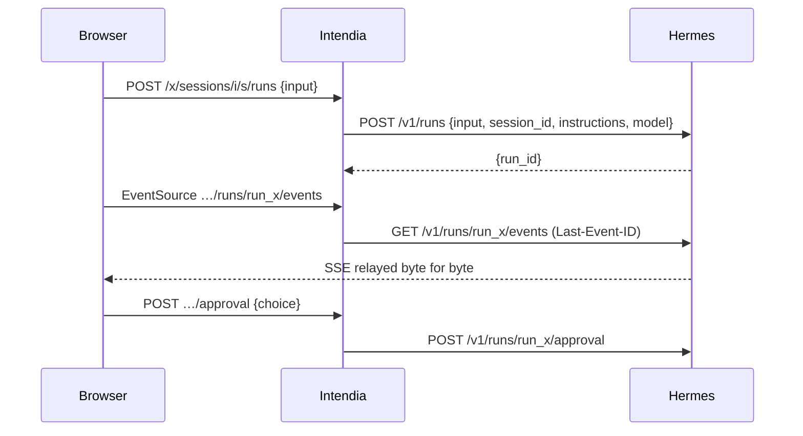

# Architecture

```
apps/server        Hono on Node 24: /x/* API, static SPA, (later) MCP on 3001
  src/hermes/      http.ts — the only HTTP client to Hermes; surface.ts — discovery
  src/connectors/  one folder per module: operations, candidate routes, zod schemas
  src/compat/      engine (route resolution + probes), service (scheduling, history), notify (webhook)
  src/cli/         probe (record / diff), hash-password
apps/web           React 19, Vite, TanStack Router + Query, Tailwind 4
apps/fake-hermes   replays fixtures/ as both Hermes APIs; can break routes on demand
fixtures/          probe recordings, one folder per Hermes version
```

## How a module stays alive across Hermes updates

Each operation of a module (`connectors/<module>/index.ts`) declares:

- `kind`: read or write; `required` reads are needed for the module to work at all;
- `routes`: candidate routes by preference, each on the API server (`api`) or the dashboard (`dash`);
  an API server route may name its `capability` (key in `/v1/capabilities.endpoints`) and `feature` flag;
- `schema`: tolerant zod schema of the fields Intendia reads (`looseObject`: unknown fields are kept).

The compatibility engine (`compat/engine.ts`), for every operation, walks its routes:

1. API server route: skipped if the API is unreachable, if its feature flag is `false`, or if its capability is
   missing from `/v1/capabilities`. When the capability exists, **its announced path replaces the default one**:
   a route moved by Hermes is followed without a code change.
2. Dashboard route: skipped if no dashboard is configured or reachable, or if the route is absent from `/openapi.json`.
3. Read routes without parameters are called and validated against the schema; a failure moves on to the next route.

Module state: `unavailable` if a required read has no working route, `readonly` if a write has none, `full` otherwise.
At runtime `connectors/runtime.ts` (`callOp`, `streamOp`) only uses the route chosen by the last report.

Checks run at start-up, when `/health/detailed` announces a new version (polled every 5 minutes), every 24 h and on
demand from the State screen. State changes go to the webhook.

## Workspaces, sessions and runs

- A workspace (`workspaces` table) = a folder `<mount>/<slug>/` on the volume shared with one instance, served by one
  Hermes profile and one model. `src/workspaces/fs.ts` creates it (`mkdir` without `recursive`, removed if anything
  fails); `src/workspaces/service.ts` owns the rows.
- Intendia mints session ids (`iw-<slug>-<12 base36>`) and records them in `session_workspace` before the first
  message; Hermes creates the session on the first run that carries the id and reloads its history on every run.
- Every run sends `instructions`: workspace name, working folder as the agent sees it (`agentMount`), the session
  folder, the `share_file` rule, and the first 4 KiB of `AGENTS.md`.
- Routes of an Intendia session live under `/x/sessions/<instance>/<id>/…`: the server reads the workspace profile and
  calls Hermes through `/p/<profile>/` with that profile's key.
- Stream: `GET …/runs/<run>/events` relays Hermes's SSE bytes as they are (`id:` = `seq`), forwarding `Last-Event-ID`.
  The browser's `EventSource` reconnects by itself and only gets what it missed. A non-stream answer from Hermes
  becomes one `intendia.error` frame. The client closes the stream on a terminal event; `replay.truncated` is a warning.
- One run at a time per session: sending while the last run is not terminal answers 409.

## Files, share links and MCP

- **Every path chosen by the browser or the agent goes through `src/files/paths.ts`** before any disk access:
  `normalizeRel` (no `..`, NUL, backslash, absolute path), `resolveInside` (realpath must stay under the workspace, or
  under the mount for `share_file`; `create` mode refuses an existing name, dangling links included, then writes with
  `wx`), `resolveEntry` (delete and move act on a symbolic link itself, never on its target), `toVolumePath` (agent or
  Intendia absolute path → path relative to the mount). Known limit: a race between the realpath check and the open
  (no `openat`/`O_NOFOLLOW` in Node).
- The disk is the only source: `src/files/service.ts` reads it on each request (tree, search, raw, upload in a stream,
  move, delete, text save with an mtime check, batch `exists` for chat chips). No file list in the database, no watcher.
- Everything served from the volume (`raw`, `/f/*`) carries `Content-Security-Policy: sandbox; frame-ancestors 'self'`
  (`src/files/send.ts`): agent HTML or SVG gets an opaque origin. Only these responses allow framing by Intendia
  (`X-Frame-Options: SAMEORIGIN`), everything else stays `DENY`. The web preview adds `<iframe sandbox="">` for HTML/SVG,
  not for PDFs (Chrome refuses PDFs in sandboxed frames).
- Share links (`share_links`, `src/links/service.ts`): 10-character base62 token, path relative to the instance mount,
  private by default, public until a date (365 days max), revoked rows kept so `/f/<token>` can say so. A move from the
  explorer rewrites link paths by exact prefix in the same SQLite transaction as the rename (the rename is last).
  `GET /f/<token>` order: unknown/revoked → 404; logged in → file; private → `/connexion?suite=/f/<token>` (the login
  page sends a logged-in user straight back with a full page load, since the `SameSite=Strict` cookie is not sent on a
  navigation from another site); public expired → 410; public → file; missing file → 404 (old path shown to the owner).
- MCP (`src/mcp/server.ts`, port `INTENDIA_MCP_PORT`): hand-written JSON-RPC over Streamable HTTP, stateless, JSON
  answers only; `initialize`, `ping`, `tools/list`, `tools/call` with the single tool `share_file`. Checks: method (405),
  instance (404), bearer token (`settings` key `mcp_token:<instance>`, 401). The agent only ever gets a private link.
- `src/services.ts` builds `WorkspaceService`, `LinkService` and `FileService` once; the web app and the MCP app share them.



## Crons

- `src/crons/service.ts` (`CronService`) calls the `crons` connector; `src/routes/crons.ts` serves
  `/x/i/:inst/crons...` and `/x/crons/upcoming`. Dashboard routes first, API server as a fallback (no history, no
  cancel: the module is then read-only and the page says what is missing).
- Hermes stays the only source: no table. A cron attached to a workspace has a block at the very start of its prompt
  (`[Intendia] Workspace : <name> (<slug>) ; dossier : crons/<key>` ... `[/Intendia]`) asking the agent to read
  `AGENTS.md`, store its files in `<agentPath>/crons/<key>/` and use `share_file`; `workdir` is set to the
  workspace. `unframe` strips the block on read; detaching clears `workdir`. `<key>` is the slug of the cron name when
  first attached, never changed afterwards, unique among the instance's crons and the folders on disk.
- An attached cron is created on the workspace's profile; attaching a workspace of another profile is refused.
- Every action carries the job's `profile` (`?profile=`); Hermes answers 404 when the job is not in it.
- The browser builds the schedule (`apps/web/src/crons/schedule.ts`, plain French forms → `every Nm`, cron
  expressions or an ISO timestamp) and follows "Run now" by polling every 2 s until `last_run_at` changes.

## Rules (enforced by `apps/server/test/boundaries.test.ts`)

- Only `src/hermes`, `src/connectors`, `src/compat` and `src/cli` import `hermes/http.ts`.
- No reference to Hermes files (`config.yaml`, `state.db`, `gateway_state.json`) nor to its Python code.

## When Hermes changes

1. The State screen (or the weekly CI issue) names the operation and the route.
2. `pnpm probe record` against the new version, then `pnpm probe diff fixtures/hermes-<old> fixtures/hermes-<new>`.
3. Fix the connector (new candidate route or schema field), commit the new fixtures; the tests replay them.
